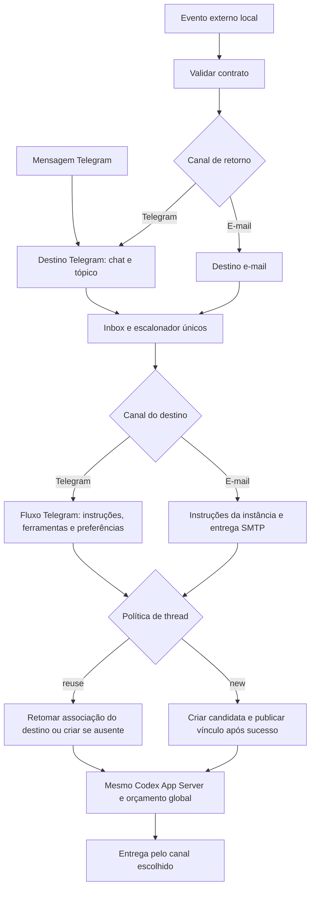

# Eventos e agendamentos

Especificação aprovada em 2026-11-10. A disponibilidade operacional depende das etapas implementadas e validadas, não da publicação deste contrato.

Implementação atualizada em 2026-11-11: contrato distribuível, núcleo multiorigem, listener HTTP local, entregas Telegram/e-mail, conclusão silenciosa explícita, logs e incidentes, agendador TOML, intervalos ancorados, checagem automática de e-mail, ações, CLI e setup. A suíte completa no Windows aprovou 3.317 testes e 301 subtestes, com 47 testes ignorados. Resultados, limites e comandos estão no [registro de validação](validacao-eventos-agendamentos.md). Nenhum destino real foi acionado e nenhum serviço operacional foi habilitado durante o desenvolvimento.

## Eventos do agente

Ingresso HTTP exclusivamente local em `127.0.0.1:39392` (porta configurável), no mesmo processo, inbox, banco, App Server e limite de turnos do Telegram. `POST /v1/events` usa `wait=true` por padrão; `wait=false` confirma com HTTP 202 depois da persistência. Acompanhamentos longos respeitam `long_limit`, padrão 32, e saturação retorna 429 antes do aceite. O RPC interno `notification.submit` permanece como compatibilidade administrativa. Não há TLS nem autenticação porque o listener nunca aceita bind externo. Desconectar não cancela; não existe consulta de resultado por UUID nem cancelamento pelo emissor.

O ingresso do evento acontece antes da seleção do canal e da thread. Quando o retorno é Telegram, a entrada usa exatamente o fluxo de instruções, ferramentas, preferências, associação de thread e entrega daquele chat/tópico. A origem serve para prioridade e auditoria; não cria outro contexto de thread. `reuse` pode continuar uma thread iniciada por mensagem Telegram e mensagens posteriores podem continuar a thread iniciada pelo evento. O contexto efetivo é escolhido pelo canal de retorno, não pela origem. Retorno e-mail usa as instruções da instância, sem ferramentas de conversa Telegram. Esclarecimento funcional do proprietário registrado em 2026-11-10.



Envelope JSON v1 fechado: `schema_version=1`, UUIDv7 em `event_id`, `prompt` não vazio e `thread_policy` igual a `new` ou `reuse`. Telegram exige `response_channel={type,value}` e proíbe os campos de e-mail. E-mail exige também `account` e `subject`. O schema é distribuído no pacote Python e cada recebimento do mesmo UUID executa novamente. O corpo HTTP tem limite fixo de 1 MiB. A fila aceita no máximo 50 itens por destino e 1.024 globais; saturação rejeita antes do aceite. Perda de conexão não autoriza reenvio automático.

Telegram tem prioridade sem preempção. Destinos ocupados são pulados, sem bloqueio de toda a fila. A capacidade de turno é liberada na terminalidade; destino fica reservado até entrega/limpeza. Incerteza conserva a proteção até reconciliação.

`reuse` continua a associação vigente ou cria uma thread quando não existe. `new` troca o vínculo após o primeiro turno concluído com sucesso, antes da entrega. Falha do turno conserva associação anterior; falha da entrega não desfaz troca concluída. Ausência conclusiva da thread permite substituição; erro transitório não elimina vínculo.

Sem retry automático de execução ou entrega. Pendentes comprovadamente não enviados retomam; submissões e envios possivelmente iniciados são reconciliados, nunca repetidos cegamente. O acompanhamento aceito retorna estado terminal `completed`, `failed` ou `uncertain`, além do UUID, recepção UTC, `result`, seu alias compatível `execution` e `delivery`. Um resultado concluído cuja entrega falhou continua retornando HTTP 200, com `status=failed`, `result=completed` e `delivery=failed`. Resposta textual vazia falha com `empty_agent_result` e não é entregue. Em um evento, a ferramenta dinâmica `onmyoji_gateway.complete_silently` permite concluir com sucesso e registrar a entrega como suprimida; ela não é autorizada para uma conversa comum. Confirmação SMTP significa aceitação pelo servidor.

A conta SMTP e o assunto pertencem ao próprio evento; o remetente vem da conta selecionada. A chave idempotente é `gateway:<inbox-id>:delivery` e o transporte existente aplica SMTPUTF8 quando necessário. Incidente global opcional usa o mesmo modelo de destino, com resumo, referência ao log e uma tentativa sem agente nem recursão.

Timestamp UTC RFC3339 com milissegundos. JSONL diário em `configs/daemon/runtime/logs/agent-gateway`, com retenção de 20 dias e limpeza inicial/diária somente dos logs reconhecidos. Pendências de escrita ficam registradas transacionalmente no banco comum; nunca em outra fila de execução.

## Agendamentos

Serviço independente `task-scheduler`, namespace `task.`, com SQLite próprio apenas para ocorrências e histórico. A fonte de verdade é um TOML versionado por agendamento em `configs/daemon/services/task-scheduler/schedules/<id>.toml`. O serviço verifica mtimes a cada cinco segundos; arquivo inválido pausa aquela definição e expõe diagnóstico. Alterações não mudam o snapshot de uma execução em curso e exclusão impede o próximo início.

Regras fechadas: `once` recebe instante ISO8601 com offset; `cron` recebe expressão de cinco campos e timezone IANA obrigatório; `interval` recebe `anchor_at` ISO8601 com offset e `every_seconds` inteiro entre 60 e 31.536.000. Intervalos são calculados sempre a partir da âncora, sem derivar a próxima ocorrência do horário em que a execução anterior terminou. O runtime usa `croniter>=7,<8`. Cron aceita números, listas, intervalos e passos, sem macros. Horário civil inexistente por DST é pulado e horário duplicado executa somente na primeira ocorrência.

Disparos vencidos consolidam uma ocorrência na data mais recente. Cada definição admite no máximo uma ação ativa e uma pendência consolidada; não há retry. O limite global padrão continua em quatro ações. Desabilitar, invalidar ou excluir um TOML descarta o que ainda não cruzou a fronteira externa, sem interromper a ação em curso.

Ação `event` guarda o envelope sem UUID; cada ocorrência gera um UUIDv7 novo e chama o listener HTTP local. Perda de confirmação gera incerteza, sem reenvio. Ação `script` informa caminho `.py` relativo ao workspace e lista de argumentos. Ela usa o Python do runtime do daemon, sem shell, com timeout padrão de 900 s configurável, contenção de árvore e captura limitada de stdout/stderr. Um script que queira emitir evento chama explicitamente o listener; o agendador não interpreta sua saída como evento.

A ação interna `email_check` pertence aos arquivos com `managed_by = "onmyoji.email-monitor"`. Ela chama diretamente o monitor pelo Python do runtime MCP, sem iniciar agente, e aceita conta e timeout de 30 a 3.600 segundos. Os arquivos `onmyoji-email-<conta>.toml` são materializados pela configuração de e-mail; colisões com definições comuns são recusadas e remoção/desabilitação apaga somente arquivos cuja propriedade foi confirmada.

Reinício retoma pendentes comprovadamente não iniciados; ativos sem resultado ficam incertos e não são repetidos. O histórico terminal é mantido por 20 dias, inclusive depois da exclusão do TOML; pendências e incertezas não expiram.

## Setup e implantação

### Uso local

Instale/valide o runtime pelo setup para incluir `croniter` e `tzdata`. Configure o workspace e habilite o App Server na plataforma antes de usar eventos. Para entrega por e-mail, configure uma conta SMTP existente e informe seu nome em cada evento ou incidente. Para checagem automática, configure o recebimento IMAP/POP3 e as opções 11 e 12 da conta em `MCP > E-mail`; veja [E-mail por protocolos comuns](../onmyoji-daemon/docs/mcp-email.md). Em `Daemon > N. Eventos do agente` configure habilitação, porta, incidente e diagnóstico. Para Telegram, cadastre o destino no catálogo pelo fluxo `/channel` existente.

Os exemplos abaixo usam o executável `onmyoji-daemon`; também é possível chamar o mesmo módulo com o Python configurado: `python -B -m onmyoji_daemon.cli`. Substitua `C:/instancias/Shikigami` pela raiz da instância.

```text
onmyoji-daemon --onmyoji-root C:/instancias/Shikigami enable task-scheduler
onmyoji-daemon --onmyoji-root C:/instancias/Shikigami start task-scheduler
onmyoji-daemon --onmyoji-root C:/instancias/Shikigami task list
onmyoji-daemon --onmyoji-root C:/instancias/Shikigami task preview --id <id> --count 5
onmyoji-daemon --onmyoji-root C:/instancias/Shikigami task history --id <id>
```

Exemplo de `schedules/resumo-diario.toml`, inicialmente desabilitado:

```toml
schema_version = 1
enabled = false
description = "Resumo diário"
created_at = "2026-11-11T12:00:00-03:00"

[time]
type = "cron"
expression = "0 9 * * 1-5"
timezone = "America/Sao_Paulo"

[action]
type = "event"

[action.event]
schema_version = 1
prompt = "Prepare o resumo solicitado."
thread_policy = "reuse"

[action.event.response_channel]
type = "telegram"
value = "group:-1001234567890:42"
```

Para script, use `[action]`, `type = "script"`, `path = "rotinas/resumo.py"`, `args = []` e, opcionalmente, `timeout_seconds = 900`. O arquivo deve existir dentro do workspace. Definições ficam em `configs/.../schedules`; saídas ficam em `<workspace>/.onmyoji/task-scheduler/`.

Edite, renomeie ou remova o TOML para administrar definições. `task resolve <ocorrencia> --reason <motivo> --confirm` registra conferência manual sem repetir a ação. Autoria remota/MCP não integra a versão 1. `notification submit --file <evento.json>` permanece como adaptador compatível para o ingresso.

A configuração local de eventos está em `configs/daemon/services/telegram/notification.json`; os limites de execução continuam no `config.toml` desse serviço. O agendador usa `max_parallel_actions=4` e `script_timeout_seconds=900` em `configs/daemon/services/task-scheduler/config.toml`; alterações exigem reinício. Não edite o SQLite.

### Recuperação e ativação

Contextos separados em `D. Daemon`: `N. Eventos do agente` e `A. Agendamentos`. A listagem de agendamentos é navegável e somente leitura; `X` volta. As dez colunas ordenáveis são ID, status, ação, expressão, timezone, próxima execução, criado, canal, política de thread e último resultado. Atalhos `1`–`0` invertem a direção quando repetidos; são 20 itens por página, `P` anterior e `N` próxima. A ordem padrão é próxima execução crescente, ausentes por último e ID como desempate.

Recursos novos desabilitados por padrão. Backups consistentes antes de migração; versão antiga recusa banco novo. Sem downgrade de banco após trabalho real; correção progressiva. Testes com relógio/canais/App Server falsos, temporários em tmp/ e `python -B -m pytest`. Cada etapa validada recebe commit e push ao origin. Sem workflows GitHub nem publicação externa.
