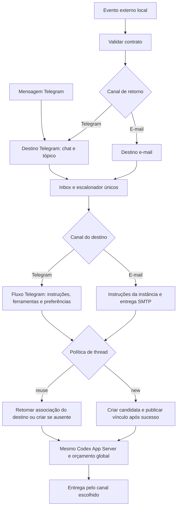

# Eventos e agendamentos

Especificação aprovada em 2026-11-10. A disponibilidade operacional depende das etapas implementadas e validadas, não da publicação deste contrato.

## Notificações ao agente

Ingresso exclusivamente local pelo Supervisor, namespace `notification.`, no mesmo processo, inbox, banco, App Server e limite de turnos do Telegram. `notification.submit` é síncrono e concorrente; desconectar não cancela. Não existe consulta de resultado por UUID nem cancelamento pelo emissor. O token interno do Supervisor permanece obrigatório; não há cadastro/autenticação adicional de emissores.

O ingresso do evento acontece antes da seleção do canal e da thread. Quando o retorno é Telegram, a entrada usa exatamente o fluxo de instruções, ferramentas, preferências, associação de thread e entrega daquele chat/tópico. A origem serve para prioridade e auditoria; não cria outro contexto de thread. `reuse` pode continuar uma thread iniciada por mensagem Telegram e mensagens posteriores podem continuar a thread iniciada pelo evento. O contexto efetivo é escolhido pelo canal de retorno, não pela origem. Retorno e-mail usa as instruções da instância, sem ferramentas de conversa Telegram. Esclarecimento funcional do proprietário registrado em 2026-11-10.

Envelope JSON v1 fechado: `schema_version=1`, UUIDv7 em `event_id`, `prompt` não vazio, `response_channel={type,value}` com tipo `telegram` ou `email` e `thread_policy` igual a `new` ou `reuse`. Schema distribuído no pacote Python. Cada recebimento do mesmo UUID executa novamente. Limite inicial de requisição completa de 1 MiB e 32 acompanhamentos longos concorrentes, configuráveis. Saturação rejeita antes de aceitar. Perda de conexão não autoriza reenvio automático.

Telegram tem prioridade sem preempção. Destinos ocupados são pulados, sem bloqueio de toda a fila. A capacidade de turno é liberada na terminalidade; destino fica reservado até entrega/limpeza. Incerteza conserva a proteção até reconciliação.

`reuse` continua a associação vigente ou cria uma thread quando não existe. `new` troca o vínculo após o primeiro turno concluído com sucesso, antes da entrega. Falha do turno conserva associação anterior; falha da entrega não desfaz troca concluída. Ausência conclusiva da thread permite substituição; erro transitório não elimina vínculo.

Sem retry automático de execução ou entrega. Pendentes comprovadamente não enviados retomam; submissões e envios possivelmente iniciados são reconciliados, nunca repetidos cegamente. Resposta contém UUID, recepção UTC, execução (`completed`, `failed`, `uncertain`, `not_started`) e entrega (`confirmed`, `failed`, `uncertain`, `not_attempted`), sem texto integral nem segundo ID externo. Confirmação SMTP significa aceitação pelo servidor.

Conta SMTP padrão selecionada explicitamente, remetente da conta, assunto `Onmyōji · evento <UUID>`. Chave privada SMTP por recepção. Incidente global opcional por Telegram/e-mail, resumo sem anexos e uma tentativa sem agente nem recursão.

Timestamp UTC RFC3339 com milissegundos. JSONL diário com retenção de 20 dias, limpeza inicial e horária somente dos logs reconhecidos. Pendências de escrita registradas transacionalmente no banco comum; nunca outra fila de execução.

## Agendador

Serviço independente `task-scheduler`, namespace `task.`, SQLite próprio. Administração por CLI/RPC: create, get, list, update, enable, disable, delete, preview, history, resolve e status. Escritas exigem serviço ativo. Revisão esperada protege alterações concorrentes.

Regras: `once(at)`, `interval(anchor_at,every_seconds)` e `cron(expression,timezone)` de cinco campos. Timezone IANA padrão America/Sao_Paulo, armazenamento UTC. Intervalo mínimo 1 s contado da âncora. Cron aceita números/listas/intervalos/passos, dia do mês e semana com OR, sem macros. Horizonte de validação 10 anos. Horário inexistente é pulado; repetido executa na primeira ocorrência. Não repetir instantes após relógio retroceder.

Disparos vencidos consolidam na ocorrência mais recente. Uma execução por definição e até quatro ações globais, configuráveis. Sobreposições consolidam em uma pendência. Desabilitar descarta pendências não iniciadas e não interrompe ativos; habilitar começa no próximo instante futuro. Atualizações não alteram snapshots de ocorrências materializadas. Exclusão recusa ativo/incerteza, preservando histórico.

Ação `notification`: parâmetros do envelope sem UUID; ocorrência gera e persiste UUIDv7 antes da chamada. Perda de confirmação gera incerteza, sem reenvio. Ação `process`: executável absoluto, argumentos sem shell implícito, cwd dentro do workspace, timeout padrão 900 s, contenção de árvore, conta do daemon. Sem sandbox de segurança. Tokens internos não passam ao ambiente. Temporários em tmp/ e stdout/stderr no workspace, limitados a 10 MiB cada com drenagem contínua.

Reinício retoma pendentes não iniciados; ativos sem resultado ficam incertos e bloqueiam apenas sua definição até resolução manual com motivo/confirmacão. Histórico terminal expira em 90 dias; definições, pendências e incertezas são preservadas.

## Setup e implantação

Contextos separados em D. Daemon: N. Notificações ao agente e A. Agendador. Listagem navegável somente leitura, X volta, oito colunas ordenáveis: nome, estado, próxima execução, criação, ação, canal, destino, política de thread. Atalhos 1–8 invertem direção; 20 itens por página, P anterior, N próxima, R atualizar, padrão próxima execução crescente, nulos no final, ID como desempate. Sem catálogo separado de modelos.

Recursos novos desabilitados por padrão. Backups consistentes antes de migração; versão antiga recusa banco novo. Sem downgrade de banco após trabalho real; correção progressiva. Testes com relógio/canais/App Server falsos, temporários em tmp/ e `python -B -m pytest`. Cada etapa validada recebe commit e push ao origin. Sem workflows GitHub nem publicação externa.
