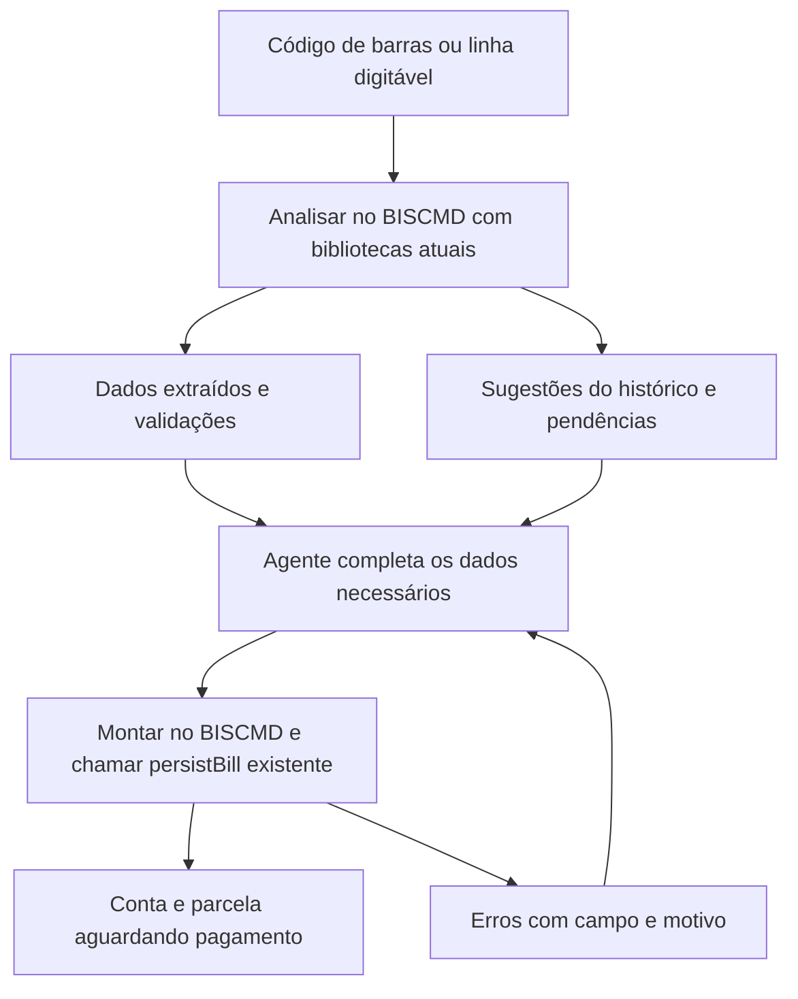

# Cadastro de contas a pagar por código de barras no BIS10 MCP

O BIS10 já interpreta códigos de barras e persiste contas a pagar. A capacidade ainda não chega ao agente porque o BISCMD e o MCP expõem apenas consultas de extrato, lançamentos manuais e transferências. A evolução deve oferecer duas etapas: analisar o código no BISCMD usando as bibliotecas atuais do BIS10 e cadastrar a conta com os complementos escolhidos pela fachada remota existente.

O resultado é um `BillVO` de débito com uma parcela `BillPaymentVO` aguardando pagamento. A conta financeira de saída só será necessária na quitação. O fluxo está implementado no BISCMD e no MCP; este plano registra as responsabilidades, os contratos e os limites adotados. O uso operacional está descrito na [documentação do MCP BIS10CMD](../mcp-bis10cmd.md).

> [!IMPORTANT]
> Código válido, dados suficientes para cadastro e confirmação bancária são condições diferentes. A interpretação atual valida estrutura e dígitos verificadores, extrai dados e consulta o histórico do BIS10. Ela não consulta o banco para confirmar registro, beneficiário ou autenticidade do título.

## Escopo aprovado

A implementação fica restrita a `bis10.biscmd` e ao MCP do Onmyōji, incluindo seus testes e documentação. `bis10.client`, `bis10.ejb`, `bis10.vaadin`, RFW, banco de dados, fachada remota e empacotamento do servidor permanecem como estão. O BISCMD reutiliza `B10Bank`, `CFlowUtils`, VOs, consultas genéricas, `createCategoryMapForBillPaymentVO` e `persistBill` já disponíveis; não publica novos métodos EJB nem substitui classes das dependências.

Preparação, complementação, verificações adicionais e montagem do agregado ficam no BISCMD. O MCP publica as ferramentas e controla as tentativas locais. A validação final, a autorização e a transação de persistência continuam a cargo do `persistBill` atual. Limitações existentes do servidor devem aparecer no contrato, sem pressupor correções fora deste escopo.

## Capacidade existente por módulo

| Componente | O que existe | Evolução necessária |
| --- | --- | --- |
| `bis10.client` | `B10Bank`, `BillVO`, `BillPaymentVO`, `CFlowUtils` e interface EJB com `persistBill` e geração de categorias | Reutilizar a dependência atual, sem alterações |
| `bis10.ejb` | Validação e gravação de contas em `CFlowCrud.persistBill`, autorização na fachada e geração parcial de categorias | Consumir os métodos existentes, sem alterações ou implantação no servidor |
| `bis10.vaadin` | `BillWindow.processCode` combina interpretação, duplicidade, sugestões históricas e preenchimento da tela | Referência de comportamento e conferência visual, sem alterações |
| `bis10.biscmd` | Conexão, sessão, seleção de empresa, consultas financeiras e escrita em extrato | Preparação contextual, montagem do `BillVO`, comandos de contas, pessoas e categorias compatíveis, com resultados e erros estruturados |
| `Onmyoji/onmyoji-daemon` | Execução do JAR, credenciais via vault, catálogo MCP, confirmação e leitura de JSON | Ferramentas tipadas, consultas auxiliares, validação das respostas e controle persistente das tentativas locais |
| `bis10.tester` | Exemplos e testes históricos de códigos em `BISUtilsBankTest` | Referência para casos novos em `bis10.biscmd/tests`, sem alterar esse módulo |
| `bis10.ear` e `bis10.distro` | Empacotamento do EJB, cliente, UI e BISCMD | Sem alteração; distribuir apenas o BISCMD atualizado e suas dependências atuais |
| `bis10.minibis` e `bis10.bis2to20` | Não apareceram como pontos de implementação desse fluxo na busca de referências | Sem alteração funcional identificada para esta entrega |

O `create_account_statement` existente constrói `AccountStatementVO` com tipo `MANUAL`. Ele não deve ser adaptado para simular uma conta a pagar. Há uma distinção adicional no domínio: um boleto comum utiliza **`BillVO.type = MANUAL` e `BillPaymentVO.type = BOLETO`**. Esse `MANUAL` é o tipo da conta, diferente do lançamento manual de extrato.

## Comportamento da interface a reproduzir no BISCMD

`BillWindow.processCode` normaliza a entrada para dígitos e chama `B10Bank.getBankSlipDataBeanFromCode`. A rotina obtém código de barras e linha digitável equivalentes, tipo do documento, moeda, valor e vencimento quando disponíveis. Alguns bancos e órgãos possuem regras adicionais para carteira, nosso número, identificação, código de receita e outras informações.

Para códigos não reutilizáveis, a tela procura uma parcela com o mesmo código canônico e impede duplicidade. Para sugerir pessoas, consulta pagamentos anteriores com o mesmo `recipientID`. Esse identificador é uma chave construída pelo parser; não é o ID de uma pessoa nem, necessariamente, um CPF/CNPJ.

No boleto, sacador e beneficiário têm papéis diferentes. A UI só copia ambos do histórico quando eram a mesma pessoa. Quando eram diferentes, copia apenas o beneficiário, evitando atribuir a fornecedores distintos a mesma intermediária financeira. Em consumo, sugere somente a concessionária/sacador. A preparação no BISCMD deve preservar esse cuidado e informar de qual pagamento veio a sugestão, consultando a fachada existente.

A geração de categorias é uma ação separada da leitura do código. `createCategoryMapForBillPaymentVO` pode produzir sugestões, itens incompletos ou falhar por falta de configuração. Isso deve gerar pendências de classificação, mantendo disponível a análise do código. Não se deve prometer que a leitura sempre completa pessoas e categorias.

## Dados necessários para a inclusão

| Informação | Boleto | Consumo convencional | Origem ou regra |
| --- | --- | --- | --- |
| Empresa | Obrigatória | Obrigatória | Selecionada na sessão de cada chamada MCP |
| Código de barras e linha digitável | Obrigatórios | Obrigatórios | BISCMD deriva ambos da entrada; BISCMD e servidor validam equivalência |
| Operação | `DEBIT` | `DEBIT` | Definida pelo BISCMD |
| Tipo de conta e de parcela | `MANUAL` e `BOLETO` | Tipos `SERVICE_*` reconhecidos | Derivados pelo BIS10 |
| Valor original e vencimento | Obrigatórios | Obrigatórios | Código quando disponível; complemento quando ausente; ambiguidades exigem resolução |
| Sacador ou concessionária | Obrigatório | Obrigatório | `BillVO.recipientPersonVO`; seleção explícita ou sugestão histórica revisada |
| Beneficiário | Obrigatório | Deve ficar nulo | `BillPaymentVO.payeePersonVO` |
| Categorias | Obrigatórias | Obrigatórias | Composição financeira cuja soma com sinais equivale ao valor final |
| Centros de custo | Obrigatórios para cada categoria | Obrigatórios para cada categoria | Distribuição total de 100%; somente centros habilitados |
| Estado | `WAITING` | `WAITING` | BISCMD monta agregado e parcela pendentes; servidor recalcula os campos derivados |
| Data de lançamento | Obrigatória | Obrigatória | Padrão definido na primeira tentativa do MCP e enviado ao BISCMD; mantido nas repetições |
| Conta financeira e data de pagamento | Não necessárias | Não necessárias | Pertencem à quitação posterior |

Consumo convencional compreende saneamento, energia/gás, telecomunicações, outras empresas e uso exclusivo bancário. Guias de prefeitura e governo usam outros contratos: sacador e beneficiário devem permanecer nulos e podem existir campos adicionais. DARF com código, por exemplo, ainda exige competência, identificação fiscal e nome do contribuinte. A análise deve informar as exigências do tipo efetivamente identificado.

O valor final mínimo é `0.01`. Multa, desconto e outros componentes devem seguir as regras de `CFlowUtils` e `persistBill`; o BISCMD calcula os totais para a preparação e o servidor os recalcula na gravação. A tela permite alterar valor e vencimento enquanto a parcela está pendente. O novo contrato deve aceitar complementos e alterações explícitas, preservando o valor extraído e apontando divergências em vez de sobrescrever silenciosamente.

## Contrato do MCP

### Analisar o código

`bis10cmd.analyze_bill_code` recebe `company_id`, `code` e, quando necessário, um contexto opcional de preenchimento. Com vários perfis, recebe também `profile`. A chamada não grava conta, não reserva código e não exige `confirm`.

A entrada é uma string, preservando zeros à esquerda. Aceitar código de barras com 44 dígitos, linha de boleto com 47 ou linha de consumo com 48, permitindo somente separadores de apresentação definidos pelo contrato, como espaços, pontos e hífens. Rejeitar letras e outros caracteres inesperados antes da normalização. O comportamento legado que admite linhas reduzidas de boleto não deve entrar implicitamente na API nova.

O retorno deve conter:

- Código canônico, linha digitável, família do código, `billType`, `billPaymentType` e indicação de reutilização.
- Dados extraídos: banco, moeda, valor, vencimento, fator de vencimento, `recipientID`, identificação e campos específicos disponíveis.
- Validações separadas: formato e DVs, suporte ao tipo, moeda, vencimento e contexto necessário para cadastro.
- Sugestões de pessoas, categorias e centros de custo, com origem e referência histórica quando aplicável.
- Duplicidades encontradas no contexto da empresa, com IDs de conta e parcela e seus estados.
- Pendências com caminho de campo, motivo, tipo de dado e restrições; alertas e erros também identificados por código estável.
- Indicação de possibilidade de cadastro conforme os dados presentes e as permissões verificáveis pela sessão atual. A análise não simula uma escrita nem garante aprovação pelo validador remoto completo.

Cada campo sugerido deve distinguir origem `BARCODE`, `HISTORY`, `CONFIGURATION`, `USER` ou `DEFAULT`. Uma inferência histórica não pode ser apresentada como dado bancário confirmado. Campos não obtidos ficam nulos e geram pendência quando obrigatórios.

Separar `code_valid`, `supported` e `ready_to_create`. Um código pode passar nos DVs e ainda exigir pessoa, vencimento ou classificação; também pode representar um tipo que o BIS10 reconhece, mas cujo cadastro ainda não está suportado pelo contrato novo.

### Cadastrar a conta

`bis10cmd.create_bill_from_code` recebe `company_id`, `code`, os complementos necessários, `request_id` e `confirm=true`. Os campos devem ser tipados no schema MCP, incluindo listas de categorias e rateios, em vez de depender de uma sequência livre em `args`.

Os complementos incluem `recipient_person_id`, `payee_person_id`, valor e vencimento quando exigidos, classificação financeira, observações e campos específicos de guias suportadas. A estrutura das categorias deve suportar vários itens, operações de desconto/acréscimo e rateios por centro de custo. Uma categoria ou rateio pode vir da configuração do BIS10, mas o resultado efetivo deve ser validado pelo servidor.

O fluxo de criação deve:

1. No MCP, consultar e registrar a tentativa por `request_id`, aplicando a exclusão mútua local antes de iniciar uma gravação.
2. No BISCMD, verificar sessão e empresa, preservando as permissões da fachada; `persistBill` continua responsável por autorizar a gravação.
3. Reinterpretar o código normalizado, resolver tipos e campos derivados e buscar pessoas, categorias e centros de custo pelos métodos existentes, respeitando contexto e elegibilidade.
4. Aplicar complementos, validar divergências e tratar avisos relevantes, como vencimento passado, de maneira explícita.
5. Consultar duplicidade imediatamente antes de gravar, sem apresentar essa consulta como reserva ou proteção contra outros clientes.
6. Construir `BillVO` e uma parcela pendente, acertar os vínculos de composição, recalcular com `CFlowUtils` e chamar o `persistBill` existente uma única vez nessa tentativa.
7. Retornar os IDs persistidos e dados efetivos; no MCP, registrar o resultado confirmado ou manter a tentativa com resultado incerto quando a resposta não permitir concluir.

O cliente não define IDs de objetos novos, estado de pagamento, vínculo com extrato, remessa, conta financeira, data ou forma de pagamento. Esses campos não pertencem ao cadastro solicitado.

`request_id` identifica uma tentativa no diário persistente do MCP. Seu escopo inclui o host/porta BIS10 configurados, a empresa e a operação; perfis com o mesmo host/porta compartilham essa identidade local. Aliases DNS distintos não são reconhecidos automaticamente como o mesmo destino. A mesma chave e o mesmo conteúdo normalizado recuperam o resultado conhecido; conteúdo diferente gera conflito. Valores padrão variáveis, como data de lançamento, ficam fixados na primeira tentativa. A chave não é enviada como nova propriedade de VO nem exige armazenamento no banco do BIS10.

### Repetição e resultado incerto

O MCP deve persistir a intenção antes de enviar a escrita e registrar código canônico, hash do conteúdo normalizado, contexto, estado e IDs conhecidos. Esse diário é estado operacional no workspace configurado, fora das fontes versionadas e de `tmp/`. A coordenação entre processos locais deve impedir o envio simultâneo da mesma solicitação e serializar criações do mesmo código por destino e empresa durante a tentativa.

Uma resposta válida com IDs permite marcar a tentativa como confirmada. Repetições recuperam esse resultado e podem conferir os IDs pelos métodos de consulta existentes. Timeout, interrupção ou resposta incompleta depois de iniciado um envio que possa gravar devem produzir `outcome_unknown`; repetir a chamada não dispara outra inclusão automaticamente, mesmo após reinício ou expiração de um bloqueio local. Enquanto houver essa pendência, uma chave nova para o mesmo destino, empresa e código também não pode disparar outra escrita; a resolução deve considerar as evidências da reconciliação e uma decisão explícita quando elas não bastarem.

A reconciliação consulta os IDs conhecidos ou procura `BillPaymentVO` pelo código canônico e carrega o `BillVO` associado. Comparar valor, vencimento, pessoas e classificação permite apresentar contas existentes compatíveis. Sem evidência inequívoca, não atribuir a criação à solicitação local: outra UI pode ter incluído a mesma conta. Ausência imediata de resultado também não autoriza reenvio, pois a chamada anterior pode continuar em execução.

Para códigos reutilizáveis ou múltiplos candidatos, manter a pendência e expor as contas encontradas, sem escolher uma delas automaticamente. Esse controle recupera resultados conhecidos e reduz repetições no mesmo MCP; não oferece execução única transacional no BIS10, não coordena UI/outros clientes e perde a associação por `request_id` se o diário for removido. Uso direto do BISCMD não recebe a proteção desse diário.

### Consultas auxiliares

| Operação proposta | Finalidade |
| --- | --- |
| `bis10cmd.list_people` | Localizar sacador/concessionária e beneficiário por nome, documento e ID, com paginação e dados mínimos para desambiguação |
| `bis10cmd.get_bill` | Confirmar o título criado e suas parcelas, sem precisar de um lançamento de extrato |
| `bis10cmd.list_bills` | Consultar por código canônico, estado e período; reconciliar inclusão e investigar duplicidade |
| `bis10cmd.get_bill_request` | Consultar o diário local por `request_id`, recuperar IDs conhecidos e apresentar o resultado da reconciliação; não é uma consulta por chave no BIS10 |
| Ampliação de `bis10cmd.list_categories` | Consultar categorias elegíveis para `billType`/`billPaymentType`, e não apenas para extrato manual |
| `bis10cmd.list_cost_centers` existente | Reutilizar a consulta de centros e rateios, validando habilitação e contexto na gravação |

Não é necessário incluir cadastro automático de pessoas para concluir esta primeira funcionalidade. Quando a pessoa não existir, a análise deve indicar a pendência e permitir retomar o fluxo depois do cadastro pelo mecanismo apropriado.

## Responsabilidades de implementação

### Dependências e fachada existentes

Reutilizar `B10Bank`, `CFlowUtils`, VOs financeiros e a interface EJB atual. Consultas de pessoas, histórico, títulos e categorias usam `findById`, `findList`, `findUniqueMatch` ou outros métodos genéricos já publicados; sugestões financeiras usam `createCategoryMapForBillPaymentVO`; a gravação usa `persistBill`. Não criar fachada, serviço, DTO compartilhado ou validação nova nesses módulos.

A operação de cadastro mantém a exigência existente de `SECKEY_COMPANY_CFLOW_BILLS_MANAGEUNPAYED`; consultas devem respeitar as permissões financeiras correspondentes. Não há endpoint remoto novo de pré-validação: `ready_to_create` representa a preparação do BISCMD, sujeita às validações finais do `persistBill`.

`BillVO` e `BillPaymentVO` usam `BISSystem.SCHEMA_COMPANY`, resolvido por `DAOFactory` para o schema da empresa na sessão. O contexto empresarial não deve ser presumido a partir da ausência de um filtro `companyId`: preservar a seleção de empresa e essa resolução de schema, verificando isolamento também nas consultas históricas e de duplicidade. Validar explicitamente que IDs recebidos são acessíveis no contexto correto.

A UI permanece inalterada. Seus comportamentos de preparação relevantes devem virar casos de contrato no BISCMD para reduzir divergências, sem copiar componentes visuais nem pressupor uma futura alteração no servidor como requisito desta entrega.

### BISCMD

Concentrar normalização, análise, enriquecimento e montagem da conta em classes específicas de `bis10.biscmd`, agrupadas por essa funcionalidade, por exemplo em `br.com.biserp.biscmd.bills.service` e `br.com.biserp.biscmd.bills.dto`. Os DTOs são locais do comando e do JSON; não atravessam a interface EJB. Na chamada remota, enviar somente os VOs já conhecidos pelo servidor. Análise e criação compartilham a preparação local; ambas reaproveitam o parser atual, com verificações adicionais descritas neste plano.

Acrescentar um comando de contas, com ações equivalentes a `analyzeCode`, `createFromCode`, `get` e `list`, mantendo conexão, sessão e empresa já existentes. Para a criação com categorias e rateios, um payload JSON estruturado evita uma gramática extensa de pares nome/valor. Preferir JSON por `stdin`, com limites explícitos de tamanho e quantidade de itens, para não depender da capacidade da linha de comando do Windows. O MCP deve iniciar o subprocesso sem shell e sem arquivos transitórios contendo dados financeiros; o payload recebe validação própria, separada das restrições de `args` dos comandos legados.

As novas ações devem emitir JSON de uma linha com o envelope já usado pelo BIS10CMD: `version`, `resource` e `items`. Recursos próprios, como `billCodeAnalysis` e `bills`, mantêm a distinção de `accountStatements`. Valores monetários e percentuais permanecem strings decimais; datas usam ISO. O recurso de análise contém um item, mesmo quando há pendências; a consulta de títulos é paginada.

A escrita também precisa de JSON estruturado. Atualmente, os comandos de escrita retornam apenas texto humano. Preservar o marcador nativo `confirm`, verificando-o antes da chamada remota, e traduzir exceções do domínio para erros com código e campo. Não depender de stacktrace ou de interpretação textual para identificar o resultado.

### Onmyōji MCP

Ampliar os conjuntos de operações e o roteamento para suportar comandos de contas, pois hoje toda escrita é encaminhada a `-accountStatement`. Publicar schemas próprios para os novos contratos; manter `company_id` em cada chamada e a confirmação de escrita já existente.

`parse_output` hoje reconhece objetos com `version`, `resource` e `items`; só valida detalhadamente o recurso `accountStatements`. Acrescentar validação dos recursos novos e exigir exatamente a resposta esperada, inclusive na escrita. Um JAR antigo ou uma saída sem IDs não deve parecer um cadastro confirmado.

O tratamento genérico de erros em `mcp/server.py` devolve somente `str(error)`, descartando `Bis10CmdError.code` e `.data`. Preservar os detalhes funcionais sanitizados no erro MCP para que o agente possa completar campos ou recuperar uma operação de resultado incerto. Distinguir rejeição funcional confirmada de falha de transporte ou resposta incompleta após possível gravação. Um timeout após envio da escrita exige consultar o diário local e reconciliar por IDs/código; não autoriza repetir a inclusão com uma chave nova.

Credenciais continuam exclusivamente no vault e no ambiente do subprocesso. Distribuir o novo JAR BISCMD com sua pasta `libs`, reutilizando as versões atuais das dependências, e atualizar o MCP. Não há atualização de BISClient, RFW, EJB, EAR, schema ou UI. Atualizar somente o Python do Onmyōji não instala os comandos novos no Java.

## Tratamento das limitações dentro do escopo

| Ponto | Evidência atual | Tratamento necessário |
| --- | --- | --- |
| Normalização | `RUBills` normaliza para validar; `B10Bank` pode continuar usando a string original nos recortes | Normalizar antes do parser e preservar zeros; cobrir a chamada direta com entrada formatada |
| Ciclos de vencimento | `B10Bank` só usa a base antiga para fatores altos quando o ano da máquina é 2025; há um ramo menor que 1000 inalcançável | Expor fator, vencimento calculado e alerta de ciclo; exigir `due_date` explícito do documento/contexto quando ausente ou ambíguo. Não corrigir silenciosamente a biblioteca; `persistBill` atual aceita o vencimento informado |
| Valor de referência | Consumo 7/9 pode produzir `value` sem moeda reconhecida | Separar `encoded_reference_value` de `amount_brl`; exigir valor efetivo explícito em BRL do documento/contexto, sem conversão presumida. Se o contexto não resolver o valor, manter pendência e não cadastrar |
| Código reutilizável | UI dispensa a pré-checagem quando `isReusable=true`, mas os metadados `unique=true` dos dois códigos são incondicionais e a validação genérica não considera essa exceção | Pedir valor/vencimento ausentes e consultar ocorrências. Se já houver cadastro, informar a limitação de reutilização do BIS10 atual; não prometer múltiplas inclusões nem alterar códigos para contornar a validação |
| Duplicidade concorrente | Há `unique=true` nos metadados, mas o SQL versionado de criação de `cflow_billpayment` não demonstra o índice correspondente | Consultar antes de persistir e coordenar as tentativas pelo MCP local. Não criar índice nem prometer atomicidade contra UI/outros clientes; refletir rejeições remotas e resultados incertos |
| Sugestão de categorias | Há tipos com categorias incompletas, dependência de propriedades e exceções de não configurado | Retornar classificação parcial e pendências; permitir preenchimento explícito |
| Tipo reconhecido | Parser reconhece mais guias que um contrato simples de consumo consegue completar | Publicar matriz de tipos cadastráveis e seus campos; não converter guia desconhecida em consumo genérico |
| Validação de DV no CRUD | Há `switch` sobre tipo possivelmente nulo e blocos que capturam erro apenas ajustando caminho do grupo | Validar formato, DVs, tipo e equivalência dos dois códigos no BISCMD antes de enviar o VO; traduzir falhas conhecidas sem alterar o CRUD |
| Comportamentos legados do RFW | JAR local aceita linhas reduzidas de boleto e contém comparação de código de banco com `==` | Exigir 44/47/48 e rejeitar explicitamente banco `000` em boletos no BISCMD. Reutilizar os DVs do RFW sem alterar ou substituir a dependência; isso não equivale a verificar banco ativo |

O reinício do fator em `1000` em 22/02/2025 está documentado nas [especificações de boleto do Banco do Brasil](https://www.bb.com.br/docs/pub/emp/empl/dwn/Doc5175Bloqueto.pdf). Como os fatores voltam a ocorrer, o contrato deve explicitar a escolha de ciclo e permitir resolver títulos históricos.

Para arrecadação, os indicadores 6/8 representam valor efetivo em reais, enquanto 7/9 podem representar quantidade de moeda ou valor de referência. A [versão 8 do layout FEBRABAN](https://cmsarquivos.febraban.org.br/Arquivos/documentos/PDF/Layout%20-%20C%C3%B3digo%20de%20Barras%20-%20Vers%C3%A3o%208%20-%2011_05_2026.pdf), vigente desde 01/06/2026, mantém essa distinção e altera a concessão de códigos no segmento 6. Usar esse layout na matriz de compatibilidade sem pressupor que a chave da empresa seja sempre um CNPJ recuperável do código.

## Sequência de entrega e critérios de aceitação

1. **Fixar os contratos sobre a API atual.** Separar boleto, consumo convencional e guias especiais; definir complementos de vencimento/valor e limites de reutilização. O primeiro conjunto operacional deve incluir boleto, água, energia/gás e telecom, com pendências explícitas para dados ausentes e demais tipos.
2. **Implementar a preparação no BISCMD.** Normalizar, chamar o parser atual, aplicar verificações locais, consultar histórico/referências e montar o agregado com os VOs existentes. Testar as composições e os comportamentos relevantes da UI sem modificá-la.
3. **Expor os comandos e consultas no BISCMD.** Implementar análise, cadastro por `persistBill`, consultas de títulos/pessoas/categorias e envelopes de sucesso/erro; verificar UTF-8, decimais e payload por `stdin`.
4. **Publicar no MCP com controle de tentativas.** Acrescentar schemas, roteamento, confirmação, diário persistente local, exclusão mútua, validação das respostas e reconciliação de resultado incerto. Identificar JAR sem os comandos novos antes de qualquer cadastro.
5. **Validar contra o servidor atual.** Conferir na UI inalterada a conta pendente criada pelo MCP, as limitações de reutilização e o tratamento de perda de resposta. Distribuir somente BISCMD e MCP e atualizar a documentação dos dois projetos.

| Grupo de testes | Comportamentos críticos |
| --- | --- |
| Entrada e DV | Nulo, vazio, zeros à esquerda, caracteres indevidos, separadores, tamanhos 44/47/48, DVs geral e dos blocos, boleto e consumo com módulos 10/11 |
| Extração | Bancos conhecidos e sem layout específico; consumo com e sem vencimento; indicadores 6/7/8/9; valores ausentes, reutilizáveis e limites monetários |
| Vencimento | Fatores 0000, 0999, 1000 e 9999; comportamento atual do parser na virada de ciclo; títulos históricos; data ausente/ambígua gera complemento explícito sem alterar a dependência |
| Pessoas | Ausentes, IDs inválidos, boleto com sacador diferente do beneficiário, intermediária compartilhada, consumo sem beneficiário, guia sem pessoas |
| Classificação | Categorias compatíveis e incompatíveis, falta de configuração automática, múltiplos itens, sinais de desconto/multa, total divergente, rateio diferente de 100%, centro desabilitado |
| Persistência | Uma conta de débito com uma parcela `WAITING`; composição e totais corretos; sem extrato, remessa ou pagamento na inclusão; rollback de validação |
| Isolamento e autorização | Empresa não autorizada, referências inacessíveis, troca de empresa entre chamadas e permissões distintas para leitura, cadastro e pagamento |
| Concorrência e repetição | Exclusão mútua entre processos do MCP, repetição de resultado conhecido, chave com conteúdo diferente, defaults estáveis, código reutilizável já existente e corrida com UI/outros clientes sem garantia de unicidade global |
| Transporte e reconciliação | JSON inválido/incompleto, ausência de IDs, JAR incompatível, falha EJB, timeout antes/depois do commit, reinício local, consulta por IDs/código e candidatos ambíguos sem reenvio automático |

O fluxo estará concluído quando um agente conseguir analisar um boleto ou uma conta de consumo, obter os complementos obrigatórios por consultas ou perguntas, cadastrar uma conta pendente pela fachada atual e confirmar seus IDs e dados. Repetições com resultado confirmado devem recuperá-lo pelo diário local. Após perda de resposta, o fluxo deve apresentar o resultado da reconciliação ou manter a pendência sem reenviar a escrita automaticamente. Nenhum critério de aceitação depende de alteração no servidor, na UI ou nas bibliotecas compartilhadas.

## Referências locais da análise

As linhas abaixo identificam a base consultada na análise de 07/11/2026. Os comandos novos, seus payloads e as garantias efetivas estão na documentação operacional do [BISCMD](C:/x/bis10.biscmd/docs/bills.md) e do [MCP](../mcp-bis10cmd.md).

| Fonte | Pontos relevantes |
| --- | --- |
| `C:/x/bis10.client/src/br/com/biserp/kernel/utils/B10Bank.java` | `recipientID` em 451; boleto em 617; vencimento em 649; consumo em 781; entrada pública em 1070 |
| `C:/x/bis10.client/src/br/com/biserp/modules/cflow/vo/BillVO.java` | Schema da empresa em 31; parcelas em 189; campos obrigatórios e estado em 195 a 318 |
| `C:/x/bis10.client/src/br/com/biserp/modules/cflow/vo/BillPaymentVO.java` | Associação em 200; valores/estado/vencimento em 239 a 308; códigos em 320 e 327 |
| `C:/x/bis10.client/src/br/com/biserp/modules/cflow/vo/CFlowCategoryVO.java` | Flags de elegibilidade em 90 e seguintes |
| `C:/x/bis10.client/src/br/com/biserp/kernel/patterns/BISFacadeRemote.java` | `persistBill` em 713; `createCategoryMapForBillPaymentVO` em 860 e cuidado com composições remotas |
| `C:/x/bis10.ejb/ejbModule/br/com/biserp/facade/BISFacade.java` | Autorização de `persistBill` em 464 |
| `C:/x/bis10.ejb/ejbModule/br/com/biserp/kernel/services/dao/DAOFactory.java` | Resolução do schema da empresa da sessão em 91 |
| `C:/x/bis10.ejb/ejbModule/br/com/biserp/modules/cflow/crud/CFlowCrud.java` | Persistência em 346; códigos em 421; pessoas em 582 e 679; categorias/rateios em 615; cadastro sem pagamento em 726; sugestões em 6493 |
| `C:/x/bis10.ejb/ejbModule/db/bis_bis_10_0_0.sql` | Criação de `cflow_billpayment` em 716 e migração da estrutura anterior |
| `C:/x/bis10.vaadin/src/main/java/br/com/biserp/vaadin/modules/cflow/windows/BillWindow.java` | Leitura em 1025; histórico em 1066 e 1114; categorias em 2635; validação/gravação em 4388 e 4415; inicialização em 4555 |
| `C:/x/bis10.biscmd/src/br/com/biserp/biscmd/main/BISCMD.java` | Catálogo de comandos em 68 e tratamento de falhas em 96 e 140 |
| `C:/x/bis10.biscmd/src/br/com/biserp/biscmd/cmd/AccountStatementCommand.java` | Criação de extrato manual em 150; confirmação e resposta em 380 |
| `C:/x/bis10.biscmd/src/br/com/biserp/biscmd/cmd/FinancialLookupCommand.java` | Categorias em 58; seleção de empresa em 130; JSON em 178 |
| `C:/x/bis10.tester/src/br/com/biserp/test/kernel/utils/BISUtilsBankTest.java` | Casos históricos de validação, conversão e interpretação de códigos |
| `C:/x/Onmyoji/onmyoji-daemon/src/onmyoji_daemon/mcp/bis10cmd/service.py` | Catálogo em 16; leitura de JSON em 98; execução em 136; roteamento em 193 |
| `C:/x/Onmyoji/onmyoji-daemon/src/onmyoji_daemon/mcp/bis10cmd/tools.py` | Schemas e publicação em 32 |
| `C:/x/Onmyoji/onmyoji-daemon/src/onmyoji_daemon/mcp/server.py` | Serialização de sucesso e falhas em 134 a 147 |

`RUBills` foi conferido no JAR local `C:/Users/rodri/.m2/repository/br/eng/rodrigogml/rfw/RFW.Kernel/1.0/RFW.Kernel-1.0.jar`; a fonte correspondente foi localizada em `C:/x/bis/rfw.kernel/src/br/eng/rodrigogml/rfw/kernel/utils/RUBills.java`. Ela não está presente no checkout atual de `C:/x/RFW.Platform`. A dependência permanece inalterada nesta entrega; as verificações complementares ficam no BISCMD.

A validação automatizada inclui os comandos Java com fachada simulada, entrada UTF-8 estrita, análise/criação, consultas e classificação; no MCP, cobre schemas, confirmação, transporte stdio real, integridade do retorno e concorrência do diário entre processos. Também foi conferida a interoperabilidade do validador Python com capabilities do JAR executado e com uma resposta produzida pelo serializer Java real. Nenhuma conta foi criada em uma instância BIS10 durante o desenvolvimento; a conferência operacional contra o ERP deve usar uma instância autorizada e um título escolhido para esse fim.
