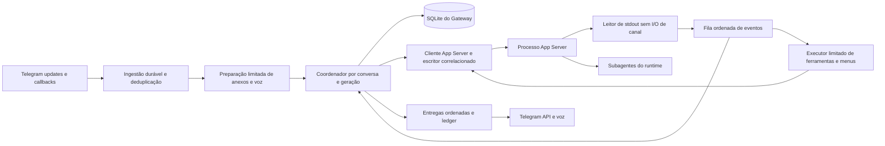
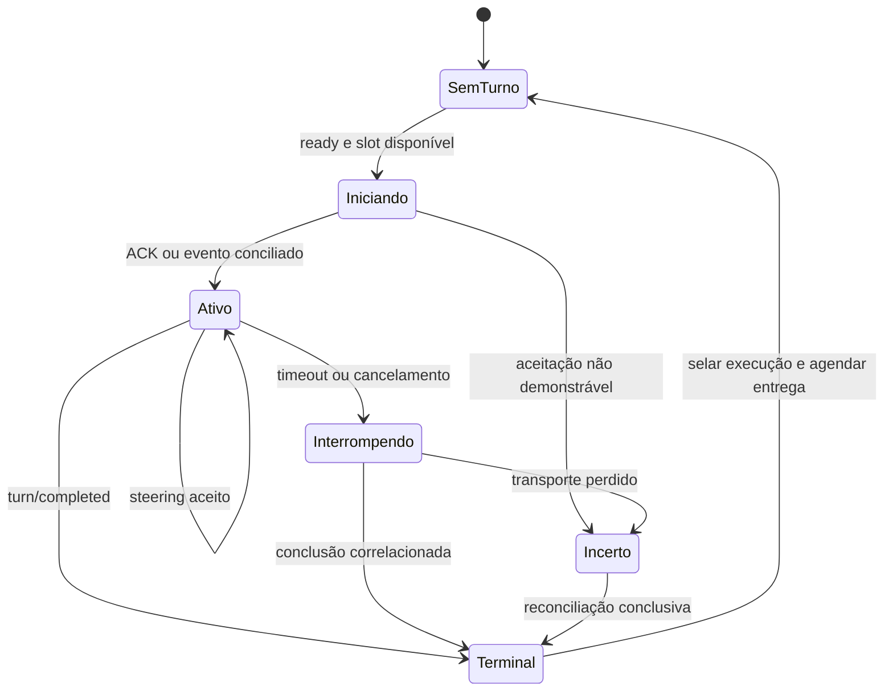

# Plano de delegação de subagentes e evolução assíncrona do Gateway Telegram

**Estado:** plano para implementação; nenhuma capacidade proposta neste documento está implantada por sua publicação.  
**Revisão:** 2026-11-05.  
**Baseline inspecionado:** `7fdf786f60283fec65f662c1efc51ae10e4c8a2b`.  
**Componente responsável:** `onmyoji-daemon`; política compartilhada e preparação de execução também atendem os clientes locais.

> [!IMPORTANT]
> A entrega desta revisão é somente o plano. Não instala integrações, não executa contas reais, não altera instruções compartilhadas, não cria perfis de especialistas e não implementa comportamento de produção. Os nomes novos de módulos, tabelas, opções e comandos abaixo são contratos propostos para a implementação.

## Navegação

1. [Objetivo e decisões](#objetivo)
2. [Baseline e fontes](#baseline)
3. [Gates de capacidade](#capacidades)
4. [Requisitos e invariantes](#requisitos)
5. [Política de delegação](#politica)
6. [Arquitetura, estados e eventos](#arquitetura)
7. [Contratos e persistência](#persistencia)
8. [Recepção, fila e steering](#entrada)
9. [Saídas, pensamentos e menus](#saida)
10. [Subagentes e continuidade](#subagentes)
11. [Ciclo de vida e recuperação](#recuperacao)
12. [Distribuição opcional de perfis](#perfis)
13. [Impacto por componente](#impacto)
14. [Sequência de implementação](#implementacao)
15. [Matriz de testes e aceitação](#testes)
16. [Validação manual controlada](#manual)
17. [Observabilidade e rollout](#rollout)
18. [Checklist de entrega](#checklist)

<a id="objetivo"></a>
## 1. Objetivo e decisões

Permitir que o principal delegue partes adequadas de uma solicitação e que o Gateway receba, registre e encaminhe novas mensagens enquanto existe trabalho em andamento, preservando contexto, procedência, limites de autorização e acompanhamento. Delegação e responsividade do canal são capacidades independentes: criar um subagente não remove a serialização atual do Gateway.

O principal continua responsável pela conversa, pelas dependências, pelas decisões e pela entrega consolidada. A base reutilizável fornece uma política e um mecanismo opcional para futuras especializações da instância Shikigami. A instalação pode permanecer sem nenhum perfil customizado.

### Decisões propostas

| Tema | Decisão executável | Motivo |
| --- | --- | --- |
| Política compartilhada | Delegar apenas quando houver ganho real; não criar catálogo de agentes genéricos | Evitar duplicar o principal e aumentar custo sem benefício |
| Compatibilidade | Primeira publicação usa `busy_input_policy = "queue"` quando a opção estiver ausente | Preservar a semântica existente durante migração e validação |
| Evolução recomendada | Oferecer `"steer"` por adesão explícita após os gates, inicialmente somente ao owner em DM privada | Correções e perguntas sobre trabalho ativo chegam ao coordenador sem esperar o próximo turno |
| Controle por mensagem | Propor `/fila <texto>` e `/direcionar <texto>`; aceitar legenda com anexos | Permitir intenção explícita sem tentar classificar semanticamente cada mensagem |
| Conversas coletivas | Manter mensagens de grupos e tópicos coletivos na fila nesta primeira evolução | A seleção de contexto e a autoridade de múltiplos participantes exigem evolução separada |
| Execução | No máximo um turno coordenador não terminal por conversa, sempre ligado a uma geração | Preservar uma ordem de decisões e efeitos externos, inclusive durante `/new` |
| Subagentes | Primeira modalidade acompanha os filhos dentro do turno coordenador | Não depender de sobrevivência após o final ou após a morte do processo |
| Entrega tardia | Desabilitada até passar um gate próprio de descoberta, acompanhamento e retomada | Uma resposta final e um processo vivo não garantem que haverá novo despertar |
| Persistência | Evoluir o SQLite existente com registros de aceitação, turno, entrega e recuperação | Evitar um serviço de jobs paralelo sem necessidade demonstrada |
| Retry incerto | Reconciliar ou pedir decisão; não repetir geração/ações automaticamente | Timeout de transporte não prova recusa da operação |

Fila versus steering não foi decidido pelo usuário. Esta é a recomendação deste plano: publicar primeiro a infraestrutura com fila compatível, validar steering e habilitá-lo gradualmente. Quando habilitado, uma mensagem comum elegível direciona o turno ativo; se não houver turno ativo, inicia um novo turno na thread existente. `/fila` sempre aguarda o fim; `/direcionar` solicita steering e informa quando precisar entrar na fila por limitação conhecida. Nenhum desses comandos implica interromper automaticamente o trabalho atual.

Ficam fora do escopo: quinze perfis temáticos, agentes de e-mail/agenda/finanças sem necessidade específica, workers duráveis independentes, novo broker externo, alterações de permissões globais, exposição remota do App Server, novas integrações reais e automações de GitHub.

<a id="baseline"></a>
## 2. Baseline e fontes

### 2.1 O que existe no checkout

Os links desta tabela são relativos a este plano e apontam para fontes vigentes; arquivos `.proposed.md` não foram considerados.

| Fonte | Comportamento confirmado | Implicação |
| --- | --- | --- |
| [codex_execution.py](../../src/onmyoji_daemon/codex_execution.py), `CodexLaunch.from_system()` | Define execução comum, `CODEX_HOME` da instância e workspace externo; prepara CLI, Console e App Server; sincroniza skills | Acrescentar perfis ao ponto central de preparação, sem três implementações divergentes |
| [instructions.py](../../src/onmyoji_daemon/instructions.py), `InstructionComposer` | Compõe regras Onmyōji, identidade, instruções locais e MCPs; Telegram recebe contrato e metadados confiáveis | Política de delegação comum; conteúdo recebido continua como input |
| [shikigami_skills.py](../../src/onmyoji_daemon/shikigami_skills.py) | Copia fontes para `.agents/skills`, com habilitação, hashes, manifesto e recusa a destinos não gerenciados | Reaproveitar princípios de posse, sem transformar o materializador de skills num leitor de agentes |
| [mcp/server.py](../../src/onmyoji_daemon/mcp/server.py) | Agrega MCPs habilitados num servidor da instância | Instrução de especialista não cria isolamento técnico de MCP |
| [telegram.py](../../src/onmyoji_daemon/telegram.py), `_poll`, `_update`, `_worker` | Recebe novas mensagens enquanto worker executa; só consome a próxima após `_turn` retornar | O bloqueio central está no despacho por conversa; não na existência do polling |
| `CodexAppServer._read_stdout` | Correlaciona RPC, mas chama handlers sincronamente | Menus aguardando seleção e HTTP Telegram podem impedir a drenagem de eventos de todas as conversas |
| `_turn`, `_turn_serial`, `_app_turn` | Lock por conversa, semáforo global, espera de `turn/completed`, interrupção por timeout | Separar despacho de entradas da espera do turno; manter limites entre conversas |
| `AppServerTurn`, `_app_notification` | Registro em memória por thread; final textual separado do sinal de conclusão; pensamentos por item | Correlacionar também turno, geração e encarnação do processo |
| `_app_server_request`, `_app_thread` | Já oferece `telegram_gateway.send_message`, mídia, figurinhas e menus | Reutilizar envio adicional existente; não apresentá-lo como novidade |
| `_app_thread` | Retoma thread persistida, reaplica composição e só esquece ID quando ausência é confirmada | Atualização de instruções não é `/new`; erro transitório não autoriza perder contexto |
| `_app_server_idle_watch`, `_app_client` | Para/recicla processo quando `app_turns` está vazio, por ociosidade ou atualização de recursos | Critério futuro deve reconhecer trabalho acompanhado e RPCs pendentes |
| SQLite do Gateway | Possui inbox e tabela `outbound_intents`; esta última não tem fluxo funcional de outbox durável | Não presumir garantia de entrega já implementada |
| Inicialização e polling | `running` retorna a `pending`; offset não é persistido; IDs da inbox são aleatórios | Crash/replay pode repetir geração e efeitos; corrigir antes de automatizar retomadas |
| `_new_conversation` | Incrementa geração e descarta contexto, fila e anexos antigos | Precisará invalidar trabalho ativo, menus e saídas antigas antes da limpeza |
| [telegram_channels.py](../../src/onmyoji_daemon/telegram_channels.py) | Outbound para destinos registrados, com histórico externo reapresentado no próximo turno | Enviar externamente não desperta automaticamente o coordenador |

Referências de uso: [Gateway Telegram](../Telegram.md), [daemon](../../../docs/daemon.md), [developer instructions](../../../docs/developer-instructions.md) e [SDD de outbound](../../../docs/sdd/telegram-outbound/design.md).

> [!NOTE]
> Há defasagens a corrigir durante a implementação: `docs/developer-instructions.md` ainda descreve nova thread após revisão estrutural, enquanto `_app_thread` retoma a existente; trechos de `docs/daemon.md` descrevem execução legada e limpeza de pensamentos depois da resposta. No código, o `finally` de `_app_turn` limpa antes da entrega final por `_turn_serial`. Este plano explicita o contrato desejado e não usa essas descrições antigas como evidência de capacidades atuais.

### 2.2 Documentação oficial e evidência local

Referências oficiais consultadas em 2026-11-05:

- [App Server: ciclo de vida, steering, eventos e esquemas](https://learn.chatgpt.com/docs/app-server). Distingue thread, turno e item; requer inicialização da conexão. `turn/steer` exige o turno esperado e não cria outro `turn/started`. `thread/resume` reabre contexto; geração começa com `turn/start`. `turn/completed` sinaliza término, inclusive falha/interrupção. O processo pode continuar vivo.
- [Subagents: perfis e herança](https://learn.chatgpt.com/docs/agent-configuration/subagents). Documenta TOML em `~/.codex/agents/` e `.codex/agents/`, com `name`, `description` e `developer_instructions`. Perfis podem ajustar modelo/esforço e reduzir capacidades suportadas, mas herdam permissões, provedor e MCPs do pai. Não assegura workers sobreviventes ao encerramento do principal.
- [Configuration Reference](https://learn.chatgpt.com/docs/config-file/config-reference). Documenta configurações de agentes e registro por `agents.<name>.config_file`; caminhos relativos partem da configuração declarante. Usar apenas campos aceitos na versão alvo.
- [Environment variables](https://learn.chatgpt.com/docs/config-file/environment-variables). Documenta `CODEX_HOME`; não estabelece explicitamente que o diretório pessoal de perfis será `<instância>/agents/` nesta integração.
- [Advanced Configuration](https://learn.chatgpt.com/docs/config-file/config-advanced). Referência para precedência e camadas; qualquer registro explícito precisa respeitar a configuração gerenciada e a confiança do workspace.

No PATH desta revisão, `codex --version` retornou **`codex-cli 0.166.0`**. Foi gerado um esquema offline com `codex app-server generate-json-schema --out tmp/delegacao-schema-20261105`, sem iniciar geração nem conexões a contas. Isso não identifica necessariamente o executável selecionado em `configs/onmyoji-system.toml` da instância de produção.

O esquema local confirma `TurnSteerParams` com `expectedTurnId`, `input`, `threadId` e campo opcional `clientUserMessageId`; `TurnStartParams` contém `toolOutput`. Também expõe item **`collabAgentToolCall`**, `receiverThreadIds`, `senderThreadId` e `agentsStates`. A página oficial usa uma forma resumida diferente, `collabToolCall`. Além disso, os filtros `parentThreadId`/`ancestorThreadId` mencionados na página não aparecem no `ThreadListParams` gerado localmente. Portanto, não implementar associação de filhos copiando exemplos da página ou presumindo esses filtros. Fixar o adaptador pelo esquema e pelos testes da versão efetivamente usada.

O esquema comprova formato, não semântica de execução, idempotência, descoberta de perfis ou sobrevivência dos filhos. Não houve teste vivo dessas capacidades nesta revisão. Os artefatos de esquema são temporários ignorados, não parte da documentação versionável.

<a id="capacidades"></a>
## 3. Gates de capacidade obrigatórios

Antes de alterar fluxo de produção, criar um relatório versionável de compatibilidade em `onmyoji-daemon/docs/validation/delegacao-app-server.md`. Registrar versão/caminho lógico do executável selecionado por `CodexLaunch`, hash do binário/esquema, SO, data, método e resultado de cada gate. Dados reais, IDs de conversas e credenciais ficam fora do relatório. Fixtures mínimas e sanitizadas pertencem aos testes; esquemas completos e capturas transitórias ficam em `tmp/`.

Usar `supported`, `unsupported` ou `unverified`, com motivo. Ausência de evidência equivale a recurso desabilitado. Atualização do binário ou mudança de transporte invalida a certificação das capacidades afetadas; não reconhecer suporte só comparando números de versão.

| Gate | Prova mínima controlada | Sucesso habilita | Alternativa concreta |
| --- | --- | --- | --- |
| G0 — base | Gerar esquema do executável configurado; handshake; iniciar, concluir, retomar thread e iniciar outro turno | Adaptador de ciclo de vida certificado | Manter fila atual; sem evolução assíncrona se base não funcionar |
| G1 — steering | Texto durante trabalho, `expectedTurnId`, recusa por turno encerrado, resposta/eventos antes do ACK, múltiplas entradas e anexos | Steering na matriz de inputs comprovada | Fila para recurso ausente; anexo não suportado fica em fila com aviso |
| G2 — reconciliação de input | Identificar na história a aceitação de `clientUserMessageId` ou outro marcador confiável, inclusive steering; testar timeout de ACK | Recuperação automática apenas dos casos comprováveis | Estado `uncertain`; não repetir; informar necessidade de decisão |
| G3 — filhos no turno | Criar dois filhos sem efeitos externos, identificar relação pai/filho e estados, aguardar resultado; testar erro e interrupção | Delegação acompanhada no turno | Principal executa sozinho; steering pode funcionar independentemente |
| G4 — descoberta de perfis | Perfil marcador TOML em workspace real e workspace sem Git, com `CODEX_HOME` customizado; verificar seleção efetiva nos três clientes e quando processos abertos leem/recarregam arquivos | Distribuição opcional naquele ambiente, sob o contrato de snapshot comprovado | Não distribuir; continuar com subagentes nativos. Avaliar `config_file` só conforme seção 12 |
| G5 — término do pai | Filho lento e inofensivo; observar final do principal, `turn/completed`, filho tardio, notificação e retomada explícita | Candidato a acompanhamento pós-turno no mesmo processo | Manter coordenador ativo até concluir/bloquear; nenhuma promessa de resposta posterior autônoma |
| G6 — parada/reabertura | Repetir G5 encerrando processo e depois Gateway; comprovar descoberta, histórico e estado recuperável de filhos | Somente a modalidade de retomada realmente observada | Marcar trabalho interrompido/indeterminado; próxima interação pode reconciliar e propor reexecução |
| G7 — dados de resultado | Entregar resultado como dado de ferramenta, preservando procedência, sem virar mensagem autorizativa do usuário | Despertar posterior do principal sob autorização já existente | Guardar resultado e aguardar próxima mensagem; não falsificar `turn/steer` de usuário |

G0–G3 são avaliados antes do rollout de steering com delegação. G4 pode falhar sem bloquear o Gateway. G5–G7 são uma extensão opcional: a primeira entrega deve funcionar com eles desligados. Uma falha não justifica construir automaticamente um sistema de jobs; exige aplicar a alternativa da tabela e documentar o comportamento disponível.

Para G7, verificar no esquema alvo e em execução `turn/start` com `input: []` e `toolOutput` de origem identificada. Esse caminho é descrito na [documentação do App Server](https://learn.chatgpt.com/docs/app-server), porém a existência do campo local não comprova que conclusão tardia desperta alguém. Se for necessário representar um evento de outra forma, exigir contrato de dados equivalente comprovado; nunca inseri-lo como developer instruction nem atribuí-lo ao owner.

<a id="requisitos"></a>
## 4. Requisitos e invariantes

| ID | Contrato de aceitação |
| --- | --- |
| RF01 | Registrar mensagem elegível de maneira durável antes de confirmar consumo do update, inclusive durante trabalho ativo |
| RF02 | Oferecer fila e steering conforme política/capacidade; registrar a rota escolhida e sua razão |
| RF03 | Receber correções, perguntas de progresso e novas tarefas sem apagar comentários/resumos já publicados |
| RF04 | Principal acompanha toda delegação até conclusão, bloqueio, cancelamento ou decisão necessária e consolida o resultado |
| RF05 | Respostas intermediárias e subsequentes usam os contratos de envio existentes; final textual não encerra registro de execução |
| RF06 | Mesma conversa mantém thread entre turnos e reaberturas; `resume` sozinho não gera resposta |
| RF07 | Preservar pensamentos compartilhados, opções de compartilhar/apagar, tópicos, modo de voz, mídia e figurinhas |
| RF08 | Tratar interrupção, crash, repetição de eventos, ACK perdido e resultado tardio sem repetir automaticamente ações externas |
| RF09 | `/new` isola nova geração de todos os eventos, menus, anexos e entregas antigos |
| RF10 | Materialização de perfis é opcional, gerenciada, sem symlinks e vazia por padrão |

Invariantes obrigatórias:

1. **Identidade:** todo trabalho e efeito de canal possui instância, `conversation_id` completo, geração, thread, turno e, quando aplicável, trabalho filho. DM e seus tópicos não compartilham chave só por terem o mesmo chat Telegram.
2. **Autoridade:** conteúdo de mensagem, anexo, transcrição, contexto externo e resultado de filho é dado de menor prioridade. Metadados confiáveis são produzidos localmente. Delegação não cria autorização nova nem contorna aprovação, sandbox ou catálogo de destinos.
3. **Ordenação:** uma entrada pode ser aceita por no máximo uma operação de início/steering comprovada. A ordem FIFO é por sequência persistida, não apenas timestamp. Recusa confirmada permite nova rota; aceitação incerta bloqueia repetição automática.
4. **Terminalidade:** apenas `turn/completed` correlacionado ou reconciliação conclusiva encerra um turno. Morte do processo estabelece interrupção/estado indeterminado, nunca sucesso. Item final e conclusão de chamada de colaboração não são conclusão de todo o trabalho.
5. **Entrega:** final só é anunciado como conclusão após estado de sucesso. Falha/interrupção com texto já produzido é parcial identificado, sem anunciar sucesso. Um filho nunca envia diretamente para o Telegram por ser filho.
6. **Limpeza:** uma mensagem nova não limpa pensamentos, staging ou outbox do turno ativo. Cleanup é limitado ao dono terminal e aos seus consumidores; trabalhos pendentes mantêm referências explícitas.
7. **Concorrência:** no máximo um turno principal não terminal por conversa, mesmo quando `/new` já criou geração seguinte; no máximo `max_parallel_conversations` conversas executando. Steering de um turno existente não espera outro slot global nem ganha um slot adicional.
8. **Privacidade:** tokens, instruções completas, texto de mensagens, transcrições, prompts de filhos e arquivos não entram nos diagnósticos; armazenamento operacional existente continua privado e não versionado.
9. **Recuperação:** não existe transação distribuída entre SQLite, App Server, Telegram e MCPs. Garantias locais e estados de incerteza devem aparecer no contrato; não prometer exactly-once externo.

<a id="politica"></a>
## 5. Política de delegação compartilhada

Introduzir posteriormente a política no recurso compartilhado [onmyoji.md](../../resources/instructions/onmyoji.md), pela composição já existente. Seu conteúdo deve incentivar delegação quando houver pelo menos um ganho claro:

- Executar em paralelo partes independentes, com pouca coordenação entre elas.
- Reduzir um contexto extenso a uma investigação delimitada e devolvê-la com evidência suficiente.
- Obter verificação independente de um resultado importante.
- Manter o coordenador atento à conversa quando o canal e o runtime realmente aceitarem novas entradas.

Tarefas curtas, indivisíveis ou profundamente dependentes da conversa permanecem com o principal. O agente deve comparar ganho com custo de contexto, tokens, concorrência e consolidação. Não há obrigação de usar subagentes em toda solicitação, nem de escolher outro modelo.

Cada delegação contém: objetivo, contexto necessário e sua procedência, recorte e exclusões, dependências, arquivos/recursos de responsabilidade, autonomia e limites de autorização, critério verificável de entrega e condições para devolver bloqueio. O principal evita escrita concorrente nos mesmos arquivos; se isso não puder ser dividido com clareza, serializa ou retém o trabalho.

Exemplo de contrato conceitual, sem ser uma API nova:

```text
Objetivo: verificar se a mudança preserva isolamento entre tópicos.
Contexto: solicitação do owner; revisar fontes e testes indicados, sem conta real.
Escopo: leitura e relatório; não implementar, não enviar mensagens externas.
Entrega: cenários verificados, evidência por símbolo/arquivo, lacunas e bloqueios.
Autonomia: escolher leituras locais; retornar se precisar de credencial ou decisão.
```

O principal registra responsabilidade, acompanha estado, redireciona/cancela quando necessário, revisa resultados e explica conclusões ou limitações. Deve permanecer no turno enquanto houver trabalho essencial acompanhado na modalidade inicial. Pode responder a uma pergunta intermediária por comentário ou `send_message`, sem produzir um final que abandone filhos. Se o runtime não o mantiver atento ao esperar, comunicar a limitação e usar fila; não prometer simultaneidade inexistente.

Não incluir na política acesso ao raciocínio interno completo. O canal apresenta apenas comentários e resumos disponibilizados pelo Codex. Ajustes em README, AGENTS, SKILL ou Markdown que defina skill, se futuramente necessários, seguem o fluxo local de versão completa `.proposed.md` e revisão do usuário; não são pré-requisito desta entrega.

<a id="arquitetura"></a>
## 6. Arquitetura, estados e eventos

### 6.1 Separação de responsabilidades

Manter o Gateway como dono do canal e introduzir unidades de responsabilidade próprias, evitando uma reescrita geral:



O coordenador é uma máquina de estados acionada por eventos, não uma thread bloqueada esperando todo `_app_turn`. Um worker de execução pode aguardar conclusão, mas não deve monopolizar o despacho de novas entradas. Usar mailbox por conversa com despertar confiável: inserção + sinalização não podem deixar item sem consumidor na corrida entre consulta vazia e saída do worker. Recuperação revarre itens prontos ao iniciar e após cada transição terminal.

SQLite continua com transações curtas e um contrato explícito de serialização do acesso. Nenhum mutex de conversa, banco ou registro de processo deve ser mantido durante HTTP Telegram, transcrição, escolha de menu ou espera de RPC. A reserva lógica do semáforo é diferente desses mutexes: representa **conversas em execução**, não operações de ingresso. Ela existe de antes de `turn/start` até terminalidade confirmada ou encerramento recuperado, inclusive durante um menu do turno; a finalização de entrega não exige manter capacidade de modelo ocupada. Recepção, callbacks e steering usam o coordenador sem adquirir outra reserva.

### 6.2 Três ciclos de vida distintos

| Objeto | Estados propostos | Persistência/identidade |
| --- | --- | --- |
| Processo App Server | `stopped → starting → initialized → draining → stopped`; falha leva a `lost` | `process_epoch` novo em toda abertura; PID não é identidade suficiente |
| Thread | `absent`, `persisted`, `loaded`, `missing_confirmed` | `codex_thread_id` por conversa/geração; sobrevive ao processo |
| Turno principal | `starting → active → interrupting → terminal`; ramificações `reconciling`/`uncertain` | UUID local de execução antes da RPC, depois `turn_id` confirmado; estado terminal inclui resultado |
| Entrada | `received → preparing → ready → dispatching → accepted`; ou `failed`, `cancelled`, `uncertain` | Chave de origem estável e sequência por conversa |
| Trabalho filho | `discovered → running → completed/failed/interrupted/blocked`; `unknown` quando não reconciliável | Ligação verificada ao principal, versão de tentativa e resultado |
| Entrega | `planned → sending → sent`; ou `retryable`, `uncertain`, `suppressed`, `failed` | Chave lógica por item/parte e IDs Telegram confirmados |

`accepted` significa input aceito pelo runtime, não atendimento concluído. A operação pode ser `start` ou `steer`. Várias entradas aceitas por steering pertencem ao mesmo turno e compartilham sua terminalidade e política de pensamentos. O estado do trabalho filho não substitui o estado do turno principal.



### 6.3 Eventos normalizados

Criar um adaptador versionado que converta wire events para `TurnStarted`, `InputAccepted/Rejected/Unknown`, `ItemCompleted`, `TurnCompleted`, `ChildObserved`, `RpcRequested`, `ProcessLost` e `DeliveryResult`. São nomes internos, não métodos supostos do protocolo.

Envelope mínimo: versão do adaptador, `process_epoch`, sequência de leitura, tipo, `thread_id`, `turn_id` quando presente, `item_id`/`rpc_id`, dono resolvido, timestamp de observação e referência privada ao payload. Em `turn/completed`, obter o ID também do objeto `turn`; eventos sem correlação suficiente não podem afetar execução nova por aproximação.

Registrar uma execução provisória antes de enviar `turn/start`. O leitor pode receber `turn/started`, itens e até conclusão antes do ACK: buffer limitado por thread/epoch associa o primeiro turno compatível à reserva; depois validar o ACK. Divergência resulta em reconciliação, sem descartar evento nem concluir outro turno. Eventos do epoch antigo são rejeitados mesmo se IDs parecerem iguais. Duplicatas usam chave de evento/item e transição idempotente; textos iguais de itens distintos não são duplicatas por definição.

<a id="persistencia"></a>
## 7. Contratos e persistência

### 7.1 Evolução do SQLite existente

Não criar outro banco para a fila. Definir migrações numeradas e transacionais, registradas em tabela própria de versão, sem trocar cegamente um eventual `user_version` já usado. Parar novos despachos durante migração, exigir uma única instância escritora e preservar backup privado consistente pelo mecanismo SQLite. Dentro do repositório, backups transitórios/testes ficam somente em `tmp/`; estado operacional fica na área privada configurada do serviço.

| Estrutura proposta | Campos/índices essenciais | Contrato |
| --- | --- | --- |
| `ingress_updates` | identidade local do bot, `update_id`, tipo, estado, referência de conteúdo, instantes; UNIQUE bot/update | Deduplicação de replay e confirmação durável antes de avançar offset |
| `inbox_items` evoluída | origem Telegram, `conversation_id`, geração, `sequence`, estado, rota solicitada/efetiva, contexto confiável, payload, anexos, erro seguro | UNIQUE da unidade lógica de mensagem; uma edição vira nova revisão identificada, nunca altera input já aceito |
| `execution_turns` | `execution_id`, conversa/geração, epoch, thread/turno, estado, resultado, revisão de recursos, início/deadlines/fim | UNIQUE de turno no epoch; índice e exclusão lógica garantem no máximo uma execução não terminal por conversa |
| `input_operations` | `operation_id`, inbox, método, turno esperado, `clientUserMessageId` quando suportado, estado, tentativa, resultado, IDs observados | UNIQUE operação ativa/aceita por inbox; registrar antes da escrita no transporte |
| `related_work` | dono, pai, thread filha, tentativa, escopo autorizado referenciado, estado, hash/ref de resultado, evento causador | Registro de acompanhamento de runtime, não fila de novos jobs |
| `gateway_deliveries` | chave lógica, dono completo, tipo, item/parte, estado, tentativas, IDs Telegram, erro, cleanup | Outbox funcional para texto/mídia/pensamentos; não supor que `outbound_intents` já implementa isso |
| `resource_references` | recurso, execução/trabalho consumidor, estado de liberação | Staging/outbox/anexos não são apagados enquanto usados |
| `gateway_checkpoints` | offset confirmado, revisão do esquema, lease da instância, política efetiva | Retomada local e diagnóstico de compatibilidade |

Definir chaves estrangeiras/índices e constraints para esses contratos nas migrações. O identificador atual chamado `chat_id` contém o identificador lógico da conversa; manter compatibilidade de leitura e nunca substituí-lo pelo chat numérico de transporte. Guardar endereço real e parâmetros de tópico separadamente e com validação local.

Não duplicar indefinidamente payloads já persistidos. Operações e métricas referenciam a inbox; histórico de resultados só armazena o necessário para reconciliação e entrega. Usar a política de retenção existente como base e acrescentar a regra: primeiro liberar consumidores, depois expurgar conteúdo; tombstones/chaves de deduplicação precisam sobreviver ao horizonte de replay configurado. Propor mínimo de sete dias para tombstones, com limite de volume e aviso antes de expurgar incertezas. Nunca expurgar automaticamente operação `uncertain` ainda não resolvida.

### 7.2 Ingestão e preparação

Uma transação registra o update e as unidades de mensagem elegíveis, com owner/origem obtidos da autenticação local, antes de considerar o update consumido. Avançar checkpoint apenas sobre o prefixo já persistido do lote ordenado efetivamente recebido, sem ultrapassar um update recebido ainda não registrado. Não exigir a existência de todos os inteiros entre dois `update_id`: lacunas numéricas não representam necessariamente perda de update. Evento inválido/inelegível também recebe classificação terminal para não bloquear esse avanço. Redelivery encontra a chave estável e não gera novo turno.

Downloads e transcrição saem do polling para um executor limitado; callbacks de controles têm caminho curto próprio. A ordem de despacho segue `sequence`: entrada 2 já preparada não ultrapassa entrada 1 ainda em transcrição. Expiração ou falha da primeira libera a próxima após aviso, sem perda silenciosa. Cancelamento e `/new` têm prioridade de controle e não aguardam preparação.

Arquivos recebidos permanecem em `<workspace>/.onmyoji/telegram/attachments/`; staging e saídas ficam no workspace. Registro privado do serviço aponta para eles sem copiar conteúdo para `configs/`. Arquivo ausente ou fora da raiz autorizada causa falha explícita daquela entrada; nunca omitir o anexo e executar uma solicitação semanticamente diferente. Verificar novamente geração e posse depois de um download lento antes de publicar o recurso.

### 7.3 Idempotência, incerteza e migração do legado

O ID JSON-RPC correlaciona uma resposta; não é garantia de deduplicação remota. A presença de `clientUserMessageId` também não prova retry idempotente. G2 deve medir se ele aparece de forma confiável na história, não apenas se o servidor aceita o campo.

- **Falha antes da escrita comprovada:** operação pode voltar a `ready`.
- **Recusa protocolar conclusiva:** registrar `rejected`; pode escolher outra rota ou iniciar turno conforme seção 8.
- **ACK recebido ou aceitação demonstrada por história/evento:** registrar `accepted`; nunca reinjetar a mesma inbox.
- **Conexão/ACK perdido após escrita possível:** registrar `uncertain`; reconciliar por ID confiável e história da thread. Se não for possível demonstrar aceitação ou recusa, não reenviar automaticamente.

Na migração, itens legados `pending` tornam-se `ready` após validar anexos; não é possível inventar sua origem para deduplicar updates antigos. Itens `running` tornam-se `uncertain_legacy`, com mensagem de recuperação uma vez por conversa e decisão de retomada, em vez do atual reset automático para `pending`. Conversas ociosas preservam thread, geração e preferências. A tabela `outbound_intents` vazia pode ser substituída por migração; se tiver registros de outra versão, preservar e migrar apenas com contrato conhecido, sem descartá-los silenciosamente.

Confirmação de Telegram seguida de crash antes do commit local deixa entrega incerta. A Bot API não recebe aqui uma garantia de idempotência criada pelo Gateway. Não retransmitir automaticamente uma entrega incerta. Retentar apenas falhas comprovadamente anteriores ao envio ou recusas recuperáveis classificadas pelo adaptador existente. Retomada de um turno não repete chamadas MCP anteriores: verificar o que foi feito e continuar do ponto autorizado; quando não houver comprovação suficiente, devolver decisão ao usuário.

<a id="entrada"></a>
## 8. Recepção, fila e steering

### 8.1 Roteamento determinístico

Propor a opção local `busy_input_policy` em `[agent]` do config do Gateway, com valores `queue` e `steer`. Ausente/valor inválido mantém fila e emite diagnóstico sanitizado. Não é uma chave de `config.toml` do Codex. Na primeira ativação, a capacidade efetiva é a interseção entre configuração, gates certificados e elegibilidade da mensagem.

| Situação após preparação e validação de geração | Rota |
| --- | --- |
| Sem turno ativo, processo inicializado | Obter slot e `turn/start` na thread carregada; se necessário, `thread/resume` primeiro |
| Sem turno ativo, processo parado | Iniciar processo, `initialize`/`initialized`, retomar thread e `turn/start` |
| Turno ativo e política `queue` | Manter FIFO; confirmar recebimento/enfileiramento com texto curto e deduplicado |
| Turno ativo, política `steer`, owner em DM privada, sem conflito de fila/configuração e input suportado | `turn/steer` com `expectedTurnId` |
| `/fila <texto>` | Persistir na fila, inclusive em política steer; não mudar política global |
| `/direcionar <texto>` elegível | Usar steering; se turno acabou, iniciar próximo turno com o mesmo input ainda não aceito |
| `/direcionar` sem capacidade ou com input incompatível | Enfileirar com aviso do motivo; não fingir que redirecionou |
| Grupo, tópico coletivo, remetente sem autoridade equivalente ou mudança de configuração que exige novo turno | Fila com regras de seleção de contexto já existentes |
| Conversa bloqueada por operação incerta | Registrar nova entrada, informar bloqueio e aguardar reconciliação/decisão; não somar outro turno |

Não deixar mensagens comuns ultrapassarem um `/fila` anterior. Uma barreira de fila ou mudança de modelo/esforço/workspace faz entradas seguintes aguardarem o próximo turno. Para redirecionamento urgente, uma ação explícita do owner pode furar essa barreira somente se o controle apresentar esse efeito e registrar a decisão; a primeira implementação pode simplesmente informar a barreira e manter FIFO. Não usar heurística de linguagem para deduzir cancelamento, independência ou prioridade.

Os novos comandos devem passar pelos mesmos controles de owner, DM/tópico, normalização de sufixo do bot, limite de tamanho, anexos e exclusão visual de comandos já adotados. Comando vazio devolve instrução de uso e não gera input vazio. `/new`, `/config`, `/channel` e `/totp` mantêm suas responsabilidades; não converter controles em texto de steering. Um eventual `/cancel` deve ser implementado como controle explícito novo na etapa correspondente, sem alegar que existe no baseline.

### 8.2 Operação de steering e corrida com término

1. Sob serialização do coordenador, selecionar a próxima entrada pronta; validar geração, owner, barreira e `turn_id` ativo. Criar `input_operations` em `dispatching`, com turno esperado e marcador estável.
2. Construir input pelo mesmo serializador usado em `turn/start`: texto, legenda, procedência e anexos. Não colocar conteúdo em developer instructions. Não enviar overrides de modelo/cwd/sandbox em `turn/steer`.
3. Liberar locks e enviar a RPC. Eventos continuam sendo drenados e persistidos. Inputs seguintes aguardam o desfecho desta operação, sem bloquear callbacks/controles.
4. Em ACK válido, conferir o `turnId`, marcar aceitação e vínculo à execução. Se `turn/completed` já chegou, a aceitação continua valendo; não iniciar novo turno com o mesmo input. Reconciliar sua presença na história se faltar correspondência.
5. Se houver recusa conclusiva de turno ausente/ID divergente, aguardar/reconciliar terminalidade do turno esperado e devolver **a mesma** entrada ainda não aceita à fila. Depois iniciar um turno na thread existente, uma única vez. Reavaliar geração antes disso. Se a consulta revelar outro turno ativo de dono desconhecido, bloquear e reconciliar a posse da thread antes de iniciar ou direcionar qualquer trabalho; divergência de ID não autoriza criar execução concorrente.
6. Se o erro for outro, classificar. Capacidade ausente desabilita steering para aquela versão e retorna à fila somente quando a recusa estiver comprovada; erro transitório após possível aceitação segue para `uncertain`.
7. Se houver timeout/EOF, executar G2. Não converter automaticamente timeout em novo `turn/start` e não repetir `turn/steer` com ID novo.

```mermaid
sequenceDiagram
    participant U as Usuário
    participant G as Coordenador
    participant D as SQLite
    participant A as App Server
    U->>G: nova mensagem durante T1
    G->>D: persistir entrada E e operação O
    G->>A: turn/steer(expectedTurnId=T1, input=E)
    alt aceita
        A-->>G: turnId=T1
        G->>D: E aceita por T1
        A-->>G: itens e turn/completed(T1)
    else T1 terminou e recusa é conclusiva
        A-->>G: erro de turno ausente ou divergente
        G->>D: O recusada; E pronta
        G->>A: turn/start na mesma thread com E
    else resposta perdida
        G->>D: O incerta
        G->>A: consultar história/estado pelo contrato validado
        Note over G,A: sem prova de recusa, não reenviar E
    end
```

ACK de steering significa recebido pelo runtime, não que uma ferramenta em curso foi interrompida nem que o modelo já reconsiderou a tarefa. Informar recebimento com precisão. A mudança de escopo deve ser reconhecida pelo principal antes de próximos efeitos; ações já enviadas a serviços externos podem exigir reconciliação, não podem ser desfeitas só pelo steering.

### 8.3 Procedência, anexos e voz durante turno

O `TelegramTurnContext` confiável do início não pode autorizar automaticamente qualquer nova origem. Nesta primeira versão, steering é restrito à mesma autoridade owner em DM; conteúdo citado/encaminhado/anexado permanece não confiável. O contrato compartilhado deve advertir que entradas posteriores trazem procedência por item, e o runtime de ferramentas deve continuar usando vínculos locais verificados. Um JSON com `source_trust: OWNER` enviado dentro do texto pelo usuário não altera autorização.

Se os metadados estruturais do turno precisarem mudar de modo que o overlay inicial não represente a entrada com segurança, enfileirar para novo turno. Não tentar atualizar developer instructions via `turn/steer`. Mudanças de modelo/esforço em `/config` aplicam-se ao próximo turno; preferências de pensamentos mantêm a leitura dinâmica descrita na seção 9.

Cada anexo aceito por steering ganha referência ao mesmo turno e ao eventual trabalho filho. Staging deixa de usar apenas thread como domínio de posse: incluir execução/turno e IDs de recursos. Transcrição automática conserva status disponível/indisponível e alerta de erros; não inferir autorização relevante de um nome próprio mal reconhecido. Falha de voz preserva o registro e informa o usuário conforme o contrato existente, sem enviar uma transcrição inventada. Se a matriz de inputs de G1 não aceitar imagem/arquivo, manter a entrada inteira na fila, preservando texto e anexo juntos.

<a id="saida"></a>
## 9. Saídas, pensamentos e menus

### 9.1 Fluxo de resposta

O principal pode enviar comentário, resposta intermediária ou mensagem adicional durante o turno. Reutilizar `telegram_gateway.send_message` e sua proteção/TTL; não introduzir uma segunda rota de envio sem os mesmos controles. `partial_answer`, quando suportado, é saída estável intermediária e deve ter classificação explícita, separada de pensamento descartável. Versões sem esse phase usam mensagens adicionais existentes.

Guardar itens finais por `item_id`/ordem, em vez de sobrescrever uma única string sem histórico. Na conclusão bem-sucedida, produzir a entrega final conforme o contrato validado da versão: normalmente o último item `final_answer` do turno; múltiplos finais legítimos exigem teste/seleção documentada no adaptador. `phase=None` só é tratado como final no caminho de compatibilidade certificado. Não enviar cada delta como mensagem nova.

Eventos de item não encerram processo nem turno. Se o usuário enviar mensagem depois de um item final, mas antes de `turn/completed`, o estado ainda é ativo: seguir G1 e as regras de corrida. Caso essa versão recuse steering nesse intervalo, a recusa conclusiva conduz à fila. Na falha/interrupção, texto já produzido pode ser entregue como parcial com estado explícito; não usar `final_text` existente para anunciar sucesso apesar do status final.

Texto formatado, divisão de mensagens, fallback de voz, `protect_content`, destinatário, tópico e figurinha `delivery: only` mantêm os contratos atuais. Supressão de texto só ocorre após envio confirmado da figurinha. Ledger de entrega registra cada parte e seu dono; registrar `bot_messages` com a geração capturada, nunca consultando a geração corrente depois do HTTP.

### 9.2 Preservação dos pensamentos exibidos

“Pensamentos” é o nome de UI dos comentários e resumos disponibilizados pelo Codex, sem promessa de acesso ao raciocínio interno completo. Preservar o compartilhamento atual e a deduplicação, evoluindo a chave para item/turno e conteúdo normalizado dentro do próprio item. Não colapsar dois comentários legítimos de itens diferentes apenas porque têm texto igual.

| Evento | Efeito sobre pensamentos |
| --- | --- |
| Nova mensagem, preparação, enqueue ou steering | Nenhuma limpeza; atualizações existentes permanecem ligadas ao turno |
| `share_thoughts` desligado via `/config` | Não publicar novos pensamentos; não apagar os já exibidos por esse ato |
| `share_thoughts` ligado | Publicar os próximos itens elegíveis, sem despejar retroativamente itens antigos |
| `delete_thoughts` alterado | Respeitar o valor da conversa/geração no fechamento, preservando semântica dinâmica atual |
| Item final recebido | Não limpar; ainda falta terminalidade do turno |
| `turn/completed` correlacionado | Selar itens e entregas anteriores; após entrega final ou aviso terminal confirmado, aplicar cleanup se habilitado |
| Final/aviso com entrega incerta | Manter pensamentos até resolução; não apagá-los deixando a conversa sem resultado visível |
| `/new` | Invalidar trabalho antigo; limpeza antiga só após terminalidade ou processo perdido confirmado, com preferência daquela geração |

O ledger guarda IDs Telegram por conversa/geração/thread/turno/item e estado de exclusão. Cleanup é idempotente e recuperável; mensagem já apagada não é erro fatal. Falha de exclusão não reabre turno nem repete resposta final. O callback do HTTP de um pensamento pode retornar depois de `turn/completed`: a barreira de entregas espera esse resultado e agenda a exclusão somente quando seu ID for conhecido. TTL explícito de `send_message` continua independente; não classificar essa ferramenta como pensamento automaticamente.

A mudança de ordem em relação ao baseline é intencional: cleanup sai do `finally` indiscriminado de `_app_turn` e passa ao fechamento do turno correspondente, depois da saída terminal confirmada. Em crash, tratar a execução como interrompida/indeterminada recuperada antes de limpar; não confundir ausência de evento com sucesso.

### 9.3 Leitor de eventos e interações

O leitor de stdout só decodifica, correlaciona respostas de RPC e despacha envelopes sem bloquear. Capturar o objeto `Popen`/epoch de cada leitor, em vez de ler `self.process` mutável; EOF resolve imediatamente pendências daquele epoch com resultado de transporte perdido. Consumidores de eventos preservam ordem por thread e terminalidade após todos os itens anteriores.

Ferramentas dinâmicas são executadas por executor limitado, fora do leitor. RPCs do servidor possuem registro de posse e resposta única; o escritor serializado devolve resultado pelo ID original. Menu não ocupa worker destinado a drenar notificações. Uma espera de seleção usa registro/token e continuação, sem prender leitor nem lock de conversa.

Menu vincula owner, endereço/tópico, geração, thread, turno, RPC e expiração. Clique é confirmado rapidamente pelo caminho de callback existente; resposta válida resolve somente a solicitação correspondente. Texto livre enquanto menu está aberto não é uma seleção: em política queue fica na fila; em steer só é injetado quando G1 comprovar esse caso, sem liberar efeitos que ainda dependem da escolha. Se a versão só reconsiderar após a escolha, informar isso; cancelamento explícito fecha o menu e resolve a RPC antes de encaminhar nova decisão.

Interrupção, `/new`, EOF e expiração invalidam o menu e respondem à ferramenta com erro/cancelamento do esquema alvo, nunca com escolha fabricada. Aprovações de ferramenta continuam sujeitas ao fluxo suportado; na ausência de UI de aprovação, falhar de forma explícita. Não aprovar automaticamente porque o solicitante é filho ou porque chegou um resultado.

Usar filas/executores limitados para evitar crescimento ilimitado. Proposta inicial: 1.024 envelopes globais em memória, 64 solicitações de ferramentas pendentes e 4 preparações de anexos simultâneas; limites ajustáveis por configuração local validada. Não bloquear o leitor ao atingir capacidade: rejeitar novas ferramentas com erro recuperável quando possível; se não houver como preservar um evento, registrar overflow e entrar em `draining/reconciling`, interrompendo admissão de novas execuções. Nunca descartar silenciosamente conclusão, input, ferramenta ou item final. Limitar também bytes por envelope conforme esquema e requisitos de anexos; payload excessivo deve falhar de forma explícita.

<a id="subagentes"></a>
## 10. Subagentes e continuidade

### 10.1 Modalidade inicial: coordenador ativo

O Codex continua sendo o orquestrador dos subagentes; o Gateway não reproduz spawn/wait nem converte toda chamada de colaboração em job próprio. Observar relações validadas em G3, registrar filhos relevantes e manter o turno principal ativo até recolher/consolidar entregas ou devolver bloqueio/decisão. A espera do principal pode aceitar steering se comprovado; não exigir um busy loop nem geração artificial para impedir finalização.

Associar filho somente por evento/história confiável do runtime vinculado a pai conhecido. Nome de agente, trecho de prompt e ID enviado no texto não são prova de relação. Para a versão 0.166.0, investigar os campos de `collabAgentToolCall`; um `item/completed` da chamada `spawnAgent` indica término da chamada de criação, não da tarefa filha. Usar estados observados/espera do runtime conforme G3. Resultados ausentes são `unknown`, não completos por silêncio.

O principal recebe resultados com origem, estado, evidência e limitações, revisa e consolida. O Gateway não repassa `agentMessage` de qualquer thread descoberta para Telegram. Ferramentas `telegram_gateway.*` ficam vinculadas ao coordenador raiz; chamadas diretas de filhos são recusadas por padrão. Se algum cenário exigir envio por filho no futuro, requer contrato explícito separado de delegação de canal e autorização, fora desta primeira implementação.

Limites de simultaneidade de filhos são os suportados no runtime alvo, conciliados com o orçamento da instância; não codificar nomes de campos novos sem validação. O limite global de conversas não conta filhos como conversas extras, mas o plano de capacidade deve considerar o custo agregado. Sem suporte ou sem capacidade disponível, principal executa em série e informa impacto quando relevante.

### 10.2 Depois do final e depois do turno

| Momento de chegada de resultado | Comportamento |
| --- | --- |
| Principal ativo antes do final | Runtime disponibiliza ao principal; ele decide e consolida |
| Item final emitido, turno ainda ativo | Registrar resultado e deixar coordenador tratar; não confundir item final com terminalidade |
| Turno encerrado, modalidade inicial | Não há promessa de filho durável. Registrar anomalia/resultado se observado e reconciliar na próxima interação; nenhuma fala direta do filho no canal |
| Turno encerrado, G5 e G7 certificados, mesmo processo | Agendar continuação do principal como dado de resultado, no mesmo contexto e geração, sob regras abaixo |
| Processo parado, G6 não certificado | Trabalho vira interrompido/indeterminado. Resultado tardio não causa reexecução automática |
| Processo reaberto, G6 e G7 certificados | Reconciliar filho por vínculo persistido e histórico; retomar principal somente se necessário e autorizado |

Extensão pós-turno exige, cumulativamente: relação filho/pai persistida antes do final; capacidade de obter estado/resultado sem adivinhação; entrega de dado com procedência validada; principal retomável; monitoramento local com prazo e despertar definido; respeito a cancelamento/geração; deduplicação da continuação. Se qualquer condição falhar, desabilitar a extensão e usar a modalidade inicial.

Quando habilitada, aproveitar o loop de coordenação e SQLite do Gateway. Resultado terminal cria um único evento de continuação por `(work_id, attempt, result_version)`; não um novo serviço de jobs. Se o principal estiver ativo, usar o mecanismo de resultado validado, com prioridade às novas instruções do usuário. Se estiver ocioso, obter slot, carregar/retomar thread e `turn/start` como saída de ferramenta em G7. `thread/resume` isolado não satisfaz acompanhamento.

Essa continuação é dado de sistema com procedência, não mensagem nova do owner. Seu escopo é revisar e entregar o trabalho previamente autorizado; novas ações externas ou ampliação de objetivo exigem autorização aplicável. Eventos só produzem uma continuação quando houver resultado material novo; notificação de progresso e histórico externo já entregue não podem criar ciclos de despertar. Limite inicial da extensão: uma continuação por conjunto de resultados terminais já registrados; nova delegação autônoma só se estiver no escopo original e permanecer acompanhada.

Se uma mensagem real do usuário estiver aguardando, processá-la antes de abrir continuação autônoma e anexar os resultados como dados. Nunca misturar `toolOutput` com `input` não vazio se o esquema não permitir. Usar a rota certificada para anexar dados na mesma execução ou dois turnos sequenciais; fallback é disponibilizar ao principal mediante consulta/registro de resultado, sem forjar fala de usuário.

<a id="recuperacao"></a>
## 11. Ciclo de vida e recuperação por cenário

### 11.1 Matriz operacional

| Cenário | Ação obrigatória |
| --- | --- |
| Turno terminou, processo continua | Manter thread; nova entrada usa `turn/start`, sem novo processo |
| Processo fechou por ociosidade | Na próxima entrada: iniciar/handshake, `thread/resume`, `turn/start` |
| Thread não existe de forma confirmada | Registrar perda de contexto; limpar apenas referência correspondente e criar thread nova. Não usar erro transitório como prova de ausência |
| Revisão de instruções/skills/MCP/perfis | Congelar snapshot por execução; agendar reconciliação e reciclagem em ponto seguro, preservando thread |
| Timeout do turno | Pedir `turn/interrupt` pelo ID correto, manter registro até terminalidade/reconciliação; não liberar recursos só porque a espera local expirou |
| Interrupção aceita, evento terminal demora | Prazo de graça proposto de 15 s; depois consultar estado. Sem prova, bloquear conversa e recuperar transporte/processo sob controle global |
| Usuário cancela | Invalidar novas entregas de trabalho cancelado, resolver menus, interromper coordenador e filhos pelo suporte certificado; reportar efeitos já confirmados |
| App Server morre | Marcar epoch perdido, resolver RPCs, manter entradas/entregas incertas, reconciliar thread antes de novo despacho |
| Gateway morre | Na próxima abertura, adquirir lease, migrar/reconciliar operações; não converter todo `running` em `pending` |
| Resultado/evento duplicado | Aplicar transição idempotente; não duplicar final, pensamento ou continuação |
| Resultado/evento tardio de geração antiga | Registrar descarte sanitizado; não entregar nem reabrir contexto atual |
| Telegram indisponível | Persistir entregas; manter ordem por conversa; retries somente para falha classificada como segura |
| Recurso/anexo removido | Falhar entrada/trabalho correspondente com motivo; não prosseguir omitindo-o |

`turn_timeout_seconds` permanece deadline de execução, não timeout do processo. Steering não renova indefinidamente esse prazo; registrar separadamente última atividade e prazo total. Quando restar pouco prazo, principal pode pedir extensão ou devolver bloqueio. Nova configuração deve explicar explicitamente se habilita extensão e seu limite; valor ausente conserva o prazo atual. Typing é sinal de atividade, não heartbeat de saúde nem prova de execução; não mantê-lo após terminalidade/perda do processo.

### 11.2 Ociosidade, reciclagem e encerramento

Substituir a condição `not app_turns` por um predicado de ponto seguro: sem turno não terminal, RPC em andamento que dependa do runtime, início/steering incerto ainda reconciliável no processo, preparação/publicação de recursos em curso para abertura e filho acompanhado que exija aquele processo. Entregas Telegram independentes já seladas não precisam manter o App Server vivo.

Aquisição de reserva de processo e decisão de parar devem ser serializadas: o idle watcher não pode parar entre verificar vazio e registrar um novo `starting`. Alterações de recursos durante trabalho ativo ficam pendentes; a próxima abertura usa um snapshot inteiro. Se o processo entrar em `draining`, novas entradas aguardam, sem abandonar recepção/callbacks.

Não conservar processo indefinidamente por um filho sem sinal. Trabalho acompanhado possui deadline e último estado observado; ao expirar, reconciliar/cancelar conforme G3/G6 e informar bloqueio. Encerramento administrativo tem prazo explícito: parar admissão, pedir interrupções, resolver menus, persistir terminalidade/incertezas e só então terminar processo. Nunca reciclar outras conversas silenciosamente para resolver uma só; se o processo compartilhado travar, registrar quais execuções serão afetadas e reconciliar todas elas antes de retomar.

### 11.3 Crash e retomada

1. Adquirir lease exclusivo do Gateway/SQLite e abrir no esquema suportado. Se houver outro escritor válido, não iniciar concorrente.
2. Reconstruir conversas, gerações, operações, entregas e referências de recursos; limpar apenas órfãos comprovados.
3. Determinar se o App Server anterior ainda existe e é propriedade desta instância. No transporte stdio atual, não presumir reconexão ao PID sobrevivente. Encerrar órfão comprovado ou declarar indisponibilidade conforme o mecanismo de supervisão, sem matar processo alheio.
4. Marcar epoch anterior perdido e iniciar outro quando necessário. Retomar threads persistidas e consultar estado/história pelos métodos certificados; não editar rollouts ou banco interno do Codex.
5. Resolver operações como aceitas, recusadas ou incertas. Sucesso já concluído gera apenas entregas faltantes comprováveis, sem nova geração. Execução interrompida precisa de continuação explícita com resumo do que foi confirmado, dentro do escopo original.
6. Sem evidência suficiente, publicar um aviso de recuperação deduplicado: trabalho interrompido, quais decisões são necessárias, sem garantir que nada ocorreu externamente. Nova autorização de retry não transforma ações externas anteriores em inexistentes; primeiro reconciliar efeitos quando possível.
7. Recuperar limpeza e retomar entradas seguramente não aceitas em FIFO. Reinicializações repetidas não reenviam avisos e não reabrem entregas `sent`.

### 11.4 `/new` e cancelamento

Tratar `/new` como transição atômica de geração, com uma barreira contra despacho/entrega: capturar contexto e preferências antigos, incrementar geração, invalidar operações ainda não enviadas, menus e saídas antigas e persistir novo estado antes de responder. Interromper trabalho antigo pelos IDs capturados. Uma chamada HTTP já em voo pode concluir depois do reset; o ledger permanece na geração antiga e não reaproveita seu resultado. Testar a janela e, se necessário, apagar uma entrega antiga confirmada quando permitido, sem apagar mensagens da geração nova.

Não remover staging/anexos ainda lidos por execução antiga antes de confirmação de término ou perda do processo. A limpeza é adiada por referências, mesmo que a nova geração já esteja disponível. Resultados antigos não são anexados ao próximo turno nem ao histórico externo atual. Eventual `thread/delete` só usa método certificado; ausência desse método não impede o reset lógico. Deletar contexto não prova interrupção de filhos ou revogação de ações externas.

A nova geração pode receber mensagens imediatamente, mas seu primeiro despacho de modelo aguarda a execução antiga atingir terminalidade ou perda do processo reconciliada. O slot antigo permanece reservado nesse intervalo; não iniciar dois coordenadores da mesma conversa enquanto o anterior ainda pode produzir efeitos. A confirmação de `/new` informa se o encerramento anterior ainda está em andamento. Se ele ficar indeterminado, bloquear despacho e oferecer recuperação, preservando as novas entradas.

Propor `/cancel` em DM para cancelar o turno ativo sem descartar a thread. Entradas ainda em fila são preservadas por padrão; a mensagem de confirmação informa isso e oferece descarte explícito separado. Até existir contrato equivalente para grupos, manter os comandos coletivos atuais e não expor controle novo sem validação de owner. Cancelamento não promete rollback externo. Retomar depois usa novo turno na mesma thread, com estado de interrupção reconhecido.

<a id="perfis"></a>
## 12. Distribuição opcional de perfis do Shikigami

### 12.1 Layout proposto e descoberta

```text
<instância>/shikigami-agents/<id>.toml       fonte opcional versionável da instância
<instância>/configs/shikigami/agents.toml    habilitação local, não versionada
<instância>/configs/shikigami/agents-runtime.json
                                           manifesto de posse por workspace
<workspace>/.codex/agents/<id>.toml         cópia gerenciada, condicionada a G4
```

Adotar arquivo TOML plano por perfil como primeira convenção, com `<id>` igual ao `name`; não copiar diretórios de skills nem interpretar Markdown como perfil. Pasta ausente ou zero habilitados é estado válido e não modifica comportamento. `.agents/agents` não é destino suportado por este plano. Não inferir `<instância>/agents` pela variável `CODEX_HOME` sem prova específica.

G4 testa o workspace externo escolhido por `-Work`, inclusive sem Git e com políticas de confiança usuais. Se a descoberta de `.codex/agents` não funcionar nesse ambiente, avaliar registro explícito `agents.<name>.config_file` somente após validar esquema/precedência da versão. O registro deve ter proprietário único no gerenciador nativo, preservar tabelas não gerenciadas e ser reversível; não concatenar TOML à configuração como texto sem controle de escopo. Se não houver camada segura, declarar distribuição indisponível, sem mexer em configuração do usuário; a política de delegação continua usando recursos nativos.

Não criar perfis exemplo em fontes da instância nesta implementação. Fixtures fictícias de teste não são um catálogo distribuído. A base fornece o mecanismo; especializações futuras precisam de objetivo distinto e contrato útil. Modelo/esforço são opcionais e só devem ser fixados quando houver necessidade comprovada e disponibilidade na conta, sem selecionar modelos por memória ou instalar integrações por causa do perfil.

### 12.2 Posse, validação e publicação

Criar `ShikigamiAgentMaterializer` em módulo próprio, integrado em `CodexLaunch`, com estas regras:

- ID com gramática restrita documentada, por exemplo `[a-z][a-z0-9_-]{0,63}`; unicidade sem distinção de maiúsculas no Windows; rejeitar traversal, caminho absoluto, nomes reservados e colisão com perfis nativos/locais.
- TOML UTF-8 válido sem BOM, limites de bytes e campos obrigatórios não vazios; validar campos opcionais pelo esquema/perfil de compatibilidade alvo. Não executar script de setup para descobrir perfil.
- Recusar symlink, junction/reparse point ou origem resolvida fora da raiz autorizada, assim como destinos e ancestrais não seguros. Ignorar propostas e arquivos transitórios; `.proposed.md` nunca é fonte vigente.
- Rejeitar campos que tentem substituir permissões, provedor ou MCPs do pai, em vez de induzir falsa segurança por configuração ignorada. Só aceitar reduções de capacidades efetivamente suportadas e testadas. Instrução “somente leitura” continua sendo orientação, não sandbox próprio.
- Manifesto registra origem canônica, destino canônico, hash, revisão do mecanismo e workspace; cópia só substitui/remove arquivo cuja posse foi demonstrada. Conteúdo local não gerenciado causa colisão clara; nunca sobrescrever para “reparar”.
- Locks por workspace e plano de publicação completo antes de alterar destinos; aberturas gerenciadas só são liberadas após revisão completa. Mudança dispara reciclagem segura do App Server, preservando threads. Lock local não oferece atomicidade multiarquivo a leitores externos que não o respeitam.

G4 precisa determinar se cada cliente carrega perfis na abertura ou os relê durante spawn/execução. Se houver leitura tardia, publicar somente após todos os leitores gerenciados terminarem, com leases de abertura e término comprovado; não assumir que ausência de `app_turns` significa ausência de CLI nativo aberto. Uma alternativa é apontar registro explícito para cópia imutável por revisão, mas somente se a versão suportar esse contrato e o gerenciador possuir aquela camada. Sem leitura inicial comprovada, leases confiáveis ou snapshot imutável certificado, desabilitar atualização automática/distribuição nesse ambiente e informar que é necessário encerrar clientes antes de materializar. Aberturas não gerenciadas concorrentes ficam fora da garantia; não prometer que verão uma revisão atômica.

Para publicação, preparar/validar conteúdo e journal em `tmp/` quando estiver no repositório. Como workspace pode estar em outro volume, copiar os candidatos para área transitória **do workspace externo**, como `<workspace>/.onmyoji/agents-staging/<operação>/`, validar hashes e publicar por substituição no mesmo volume sob lock. Não assumir `rename` atômico entre repositório e workspace. Não deixar temporários em `configs/` ou `shikigami-agents/`.

O manifesto operacional final pertence a `configs/shikigami/`. Antes da primeira substituição, persistir nele a revisão anterior e a revisão candidata em estado `incomplete`, com inventário de destinos, hashes e referências de recuperação suficientes mesmo se `tmp/` for removido. O journal transitório fica em `tmp/`; ele não pode ser a única evidência de posse. Publicar sob lock, validar o conjunto e então marcar a revisão candidata como completa. Aberturas ficam bloqueadas enquanto houver revisão incompleta. Após crash, terminar a publicação usando as fontes validadas ou restaurar a revisão anterior pelas cópias de recuperação do workspace, sem inferir posse de arquivos novos apenas pelo nome. Se a plataforma não permitir atualizar o manifesto final atomicamente com essas restrições, manter revisões com validação de integridade e estado recuperável; falha de leitura bloqueia abertura, não autoriza apagar destinos. Testar crash entre cada cópia, substituição e atualização do manifesto. Não copiar literalmente o detalhe de temporários do materializador de skills existente, que não resolve sozinho esse contrato.

No repositório próprio do Shikigami, liberar `shikigami-agents/` para versionamento conforme sua hierarquia. O `.gitignore` atual da base ignora novas pastas da raiz por padrão; a mudança futura deve liberar só a fonte, sem expor config, manifesto, credenciais ou cópias runtime. Não adicionar catálogo ao upstream nem criar diretório vazio só para aparentar suporte.

### 12.3 Habilitação e interface futura

Adicionar descoberta/habilitação local opcional análoga à de skills, sem reaproveitar execução de scripts arbitrários. Ler [setup-interface.md](../../../docs/setup-interface.md) antes de implementar interação: `screen()` somente em menu navegável com `X. Voltar`; escolhas internas numéricas com padrão explícito; confirmação `S/n` ou `s/N`; cancelamento por `X`. Diagnóstico mostra fonte, habilitação, destino lógico, revisão e capacidade de descoberta, sem expor instruções completas.

<a id="impacto"></a>
## 13. Impacto por arquivo e componente

| Componente | Mudança planejada e limite |
| --- | --- |
| `resources/instructions/onmyoji.md` | Política curta da seção 5, comum aos clientes; sem catálogo |
| `resources/instructions/telegram.md` e `instructions.py` | Contrato real de fila/steering, procedência por input e modalidade de acompanhamento; conteúdo recebido segue fora das instruções |
| `telegram.py::CodexAppServer` | Epoch, EOF imediato, erros estruturados, handlers fora do leitor, executor/RPC e buffers limitados |
| `telegram.py::Gateway` | Ingestão idempotente, coordenador, estado de turno, entrada enquanto ativo, `/new`, timeout, ociosidade e reconciliação |
| Módulos novos `telegram_execution.py`, `telegram_delivery.py`, `telegram_persistence.py` | Separar máquina de estados/adaptador, entregas e migrações conforme o crescimento exigir; evitar módulo genérico `util/common` |
| `telegram_channels.py` | Integrar ledger e correlação sem mudar catálogo de destinos nem transformar envio externo em autorização/despertar |
| `codex_execution.py`, `instance.py`, novo `shikigami_agents.py` | Preparação única, caminhos de fonte e materialização opcional; sem nova fonte de verdade para launch |
| `setupOnmyoji.py` | Expor política de entrada/capacidade e habilitação de perfis após núcleo estabilizado; obedecer interface existente |
| Testes do daemon e `tests/test_setup_onmyoji.py` | Simuladores determinísticos, migração, corridas, controles e regressões; fixtures sem contas reais |
| `onmyoji-daemon/docs/Telegram.md`, `docs/daemon.md`, `docs/developer-instructions.md` | Atualizar somente quando comportamento existir; corrigir defasagens apontadas e ligar ao plano/relatório de compatibilidade |
| `docs/sdd/telegram-outbound/` | Registrar eventual impacto contratual sem duplicar toda a arquitetura; documentação nova do componente fica em `onmyoji-daemon/docs/` |
| `docs/index.md` | Manter índice global na raiz com link para o plano e referências de uso |

Preservar encoding original em alterações futuras; novos arquivos UTF-8 sem BOM. Arquivos protegidos de instruções/skills, quando envolvidos, exigem proposta completa no mesmo diretório conforme AGENTS vigente. Este plano não exige alterar nenhum deles agora.

<a id="implementacao"></a>
## 14. Sequência de implementação com critérios de conclusão

Cada etapa deve produzir uma mudança revisável localmente. Não há dependência de workflows, gates ou automações em `.github/`. A implementação futura não está autorizada apenas pela existência deste documento.

| Etapa | Depende de | Trabalho e artefato | Critério de conclusão |
| --- | --- | --- | --- |
| E0 — certificar capacidades | Nenhuma | Executar G0–G4 em laboratório; registrar G5–G7 como desligados ou medidos; relatório de versão e fixtures de esquema | Cada capacidade tem evidência, fallback e adaptador alvo; nenhuma incógnita tratada como suporte |
| E1 — contratos/persistência | E0 | Migrações, chaves de origem, sequência, operações/turnos/entregas, estados de incerteza, upgrade legado | Migração idempotente, backup/restauração local e reinício não repetem `running`; constraints testadas |
| E2 — transporte responsivo | E0, E1 | Separar leitor/handlers, epoch, EOF, erros estruturados e executor de menus | Menu lento não bloqueia ACKs/eventos nem outra conversa; conclusão e perda de processo nunca somem |
| E3 — coordenador com fila | E1, E2 | Substituir espera monolítica por máquina de estados; preservar fila como política; preparar anexos/voz fora do polling | Equivalência funcional da fila, ordem, isolamento de tópicos, ausência de worker perdido e limite global mantido |
| E4 — entregas e pensamentos | E1–E3 | Ledger funcional, correlação por dono, barreira terminal, cleanup recuperável, finais/parciais e voz | Nova entrada não limpa pensamentos; só turno correto encerra e limpa; duplicatas/HTTP tardio não cruzam gerações |
| E5 — steering opt-in | E0/G1–G2, E3–E4 | Opção local, comandos explícitos, corrida fim/steer, inputs suportados, barreiras e avisos | Todos os casos de ACK/recusa/perda da seção 8 passam sem reinjetar input aceito |
| E6 — delegação acompanhada | E0/G3, E3–E5 | Política comum, observação de filhos, principal ativo, restrição de canal e término/bloqueio | Dois filhos independentes são consolidados; principal recebe steering se comprovado; fallback sem subagentes funciona |
| E7 — recuperação completa | E1–E6 | Timeout/interrupção, reset/cancelamento, ociosidade, reciclagem e crash entre fronteiras | Cenários da seção 11 passam; retomada não repete ação externa por timeout |
| E8 — perfis opcionais | E0/G4; independente de E5 | Materializador próprio, manifesto/journal, snapshots e setup, depois integração com E7 | Zero perfis funciona; descoberta real comprovada; colisão/crash/volume distinto preservam posse |
| E9 — extensão pós-turno | E6–E7, G5 e G7 aprovados; G6 adicional para sobreviver à parada | Monitor e continuação de principal usando dados de resultado, deduplicação e deadline | Demonstra resposta posterior no processo vivo; modalidade após processo parado só entra com G6 aprovado. Cada modalidade não comprovada permanece desligada |
| E10 — publicação controlada | E1–E7; E8 quando incluída; E9 opcional | Documentação de comportamento implementado, rollout, diagnóstico, rollback e checklist | Aceitação funcional completa da modalidade publicada; nenhuma capacidade não comprovada é anunciada |

E7 começa com os fundamentos de recuperação em E1; sua posição representa a verificação integrada, não autorização para ignorar crash nas etapas anteriores. E8 pode ser entregue depois da evolução do Gateway sem bloquear seu valor. E9 só entra no produto se a prova de capacidade justificar; sua ausência deve constar da interface e da documentação.

Antes de E5, o modo fila deve já receber novas entradas e callbacks enquanto executa, publicar atualizações e retomar threads com segurança. Antes de E6, as developer instructions de canal devem informar a capacidade efetiva, evitando incentivar promessa de conversa simultânea no fallback. Só alterar as instruções para capacidades realmente implantadas no ambiente.

<a id="testes"></a>
## 15. Matriz de testes e aceitação

### 15.1 Estratégia e execução local

Usar simulador de transporte App Server, API Telegram falsa, relógio controlável, SQLite e arquivos de fixture em `tmp_path`. Testes de corridas devem controlar barreiras/eventos, sem depender de sleeps arbitrários. Cobrir fluxos válidos, nulos/ausentes, extremos e variantes do contrato; buscar 100% nos componentes unitários novos e utilitários que forem criados, sem testar implementação interna da JDK/Python. Integração prioriza fronteiras críticas e regressões.

Executar a partir da raiz, que já configura `tmp/` por `pytest.ini` e `conftest.py`:

```powershell
python -B -m pytest onmyoji-daemon/tests/test_telegram.py onmyoji-daemon/tests/test_telegram_channels.py
python -B -m pytest onmyoji-daemon/tests/test_codex_execution.py onmyoji-daemon/tests/test_instructions.py onmyoji-daemon/tests/test_shikigami_skills.py
python -B -m pytest tests/test_setup_onmyoji.py
```

Acrescentar arquivos novos de testes dos módulos criados às chamadas pertinentes; depois executar `python -B -m pytest` para regressão integrada. Não gerar bytecode/cache fora de `tmp/`, não executar contas reais e não usar diretórios temporários padrão do SO. A revisão atual de documentação não exige executar a suíte de produção; os comandos são para a implementação.

### 15.2 Casos obrigatórios

| ID | Cenário/variações | Evidência esperada |
| --- | --- | --- |
| T01 | Update repetido, polling reiniciado, lote interrompido, IDs fora da ordem de processamento | Uma inbox por origem; checkpoint só após ingestão durável; sem entrada órfã |
| T02 | Config ausente/inválido, queue, steer sem G1, comando vazio e com sufixo de bot | Fila compatível; mensagem de uso/limitação correta, sem input inventado |
| T03 | Entrada durante `starting`, ativo, item final e `turn/completed`; eventos antes do ACK | Reserva concilia ID correto; uma aceitação e uma execução por entrada |
| T04 | Steering aceito; T1 conclui antes da RPC; conclui antes do ACK; erro ID divergente | Novo turno só após recusa conclusiva; aceito nunca reinjetado |
| T05 | ACK perdido/EOF em `start` e `steer`, com/sem marcador recuperável | Reconcilia ou fica incerto; nenhum retry cego |
| T06 | Duas mensagens rápidas, `/fila` seguido de comum, preparação lenta de voz/anexo | Ordem por sequência e barreira preservada; callbacks continuam responsivos |
| T07 | Várias conversas/DM/tópicos, semáforo saturado, steering no turno já admitido | Slots respeitados; steering não depende de novo slot; nenhuma mistura de endereço |
| T08 | Anexo ausente, path traversal, symlink/reparse, foto e voz, transcrição falha | Falha explícita, raiz e procedência preservadas; sem omissão silenciosa |
| T09 | Texto/anexo/transcrição falsifica OWNER ou instruções | Nenhuma elevação de autoridade; developer instructions sem conteúdo recebido |
| T10 | Comentários/resumos repetidos no mesmo item e iguais em itens distintos; share liga/desliga | Deduplicação por item; comportamento dinâmico preservado; sem promessa de raciocínio completo |
| T11 | Todos os pares share/delete, mensagem/steering novo, final sem completed | Nenhuma limpeza antecipada; IDs pertencem ao turno correto |
| T12 | Completed antes de HTTP de pensamento; final demora/falha/é incerto; reinício no cleanup | Barreira, retenção e exclusão idempotente, sem apagar turno seguinte |
| T13 | Final, parcial, phase ausente, final com falha/interrupção, múltiplos finais | Estado honesto; final não encerra processo; adaptador de compatibilidade certificado |
| T14 | Menu pendente, clique duplicado/owner errado/expirado, steering, `/new`, EOF | Leitor drena; resposta única à RPC; seleção e autorização não são fabricadas |
| T15 | Envio de arquivo/figurinhas/voz/TTS fallback, mensagens longas e HTML | Contratos e limites atuais mantidos; partes com chaves próprias e geração capturada |
| T16 | Filho concluído/falho/bloqueado/sem estado; chamada spawn concluída antes do filho | Principal acompanha e consolida; nenhuma terminalidade inferida da chamada |
| T17 | Filho tenta `telegram_gateway.*`, thread desconhecida ou ID de filho no input | Sem envio direto; associação exige evidência do runtime |
| T18 | Resultado duplicado/tardio; após final, completed, processo e Gateway parados | Modalidade disponível respeitada; E9 só desperta quando gates aprovados |
| T19 | Timeout, interrupt ACK e evento atrasados, interrupção sem evento, processo compartilhado | Sem cleanup prematuro; reconciliação afeta corretamente todos os donos |
| T20 | Idle/reciclagem concorre com reserva, steering, MCP/skill/perfil modificado | Snapshot coerente; processo só para em ponto seguro; thread preservada |
| T21 | Crash antes/depois da escrita RPC, ACK, commit de aceitação, envio Telegram e commit de entrega | Aceito não vira pending; incertezas não repetem ações; sucesso recupera só entrega faltante segura |
| T22 | `/new` durante download, TTS, menu, filho e envio HTTP; evento do epoch antigo | Nova geração isolada; limpeza espera consumidores; nenhum resultado antigo no histórico novo |
| T23 | `/cancel`, fila restante, nova entrada após cancelamento, reinício | Contrato de preservação da fila explícito; thread retida; efeitos externos reconhecidos |
| T24 | Migração banco legado com pending/running/thread e prefs; nova abertura repetida | Migração idempotente; `uncertain_legacy` não reexecutado; backup restaura |
| T25 | Overflow de envelopes/ferramentas/payload, Telegram lento e preparação saturada | Limites respeitados; entrada recusada/recuperada com diagnóstico; sem descarte silencioso |
| T26 | Perfis ausentes/vazios/desabilitados, TOML inválido, campos obrigatórios e capacidades inválidas | Zero perfis é válido; erros claros; nenhum override falso de permissão |
| T27 | IDs/case duplicados, colisão nativa/local, manifesto adulterado, origem/destino inseguros | Recusa sem sobrescrever/remover arquivos alheios |
| T28 | Atualizar/reparar/remover perfil, mudar workspace, aberturas simultâneas, crash/volumes distintos | Posse/revisões consistentes e recuperação de publicação; configuração não gerenciada preservada |
| T29 | CLI nativo, Console e App Server; workspace com/sem Git; `CODEX_HOME` customizado | Mesma política/preparação; perfil descoberto de fato ou distribuição desabilitada |
| T30 | Outbound para destino registrado, falha local após envio, próximo turno e E9 | Catálogo/autoridade preservados; envio não cria despertar por si; sem retry duplicado |

Preservar os testes existentes, especialmente pensamentos, contexto confiável da fila, isolamento de tópicos, retomada com erro transitório, thread ausente confirmada e reciclagem por MCP/skills. Quando o contrato mudar, atualizar a expectativa com referência ao requisito, sem apagar uma regressão para acomodar a implementação.

### 15.3 Critérios de aceitação observáveis

1. Uma solicitação longa com duas investigações independentes mostra progresso, recebe correção no meio e entrega consolidação no contexto certo. Se steering estiver desabilitado, a correção é confirmada como enfileirada.
2. Comentários e resumos já publicados continuam visíveis ao chegar nova mensagem e são limpos somente pelo fechamento do respectivo turno, conforme configuração.
3. Outra conversa continua recebendo eventos e respondendo enquanto há menu ou preparação lenta em uma conversa.
4. Novo turno na mesma thread funciona com processo vivo e após reinicialização; `resume` isolado não é apresentado como retomada de trabalho.
5. Nenhuma simulação de perda de ACK provoca repetição automática de input aceito ou de efeito externo. Incerteza aparece como estado acionável.
6. `/new` impede resultado antigo de contaminar contexto novo, inclusive nas janelas de HTTP em voo.
7. Instância sem perfis mantém todas as funções compatíveis; perfil inválido ou destino não gerenciado não é sobrescrito silenciosamente.
8. Conclusão depois do turno no mesmo processo só é prometida nos ambientes que passaram G5 e G7; sobrevivência depois do processo exige também G6 aprovado separadamente.

<a id="manual"></a>
## 16. Validação manual controlada

Fazer depois dos simuladores e com autorização específica para o ambiente de laboratório. Este plano não autoriza usar contas de produção. Usar instância descartável, workspace externo descartável autorizado, arquivos fictícios, nenhum MCP com efeitos externos e Telegram falso ou bot/chat de teste escolhido pelo operador. Se o laboratório for criado dentro do repositório, todos os seus temporários/estados de teste ficam em `tmp/`.

1. Registrar binário efetivamente selecionado, versão, SO, transporte e capacidades. Gerar esquema em `tmp/`. Conferir campos wire e fixture do adaptador, sem publicar dumps de sessões.
2. Em fila, iniciar leitura longa e mandar texto, imagem e voz fictícios. Confirmar recepção imediata, FIFO e retenção de pensamentos. Repetir com share/delete nos quatro pares.
3. Em steering certificado, iniciar duas tarefas locais independentes e pedir correção durante espera. Confirmar mesmo turno e ausência de novo `turn/started`; provocar a corrida com término e verificar novo turno só quando houve recusa.
4. Abrir menu, manter sem seleção e exercer outra conversa. Confirmar drenagem contínua, callback rápido, timeout e cancelamento sem escolha inventada.
5. Concluir, mandar nova mensagem com processo vivo; depois deixar o idle watcher fechar e mandar outra. Confirmar mesma thread e novo turno após handshake/resume.
6. Interromper processo/Gateway em fronteiras controladas. Conferir estado incerto, reconciliação e ausência de reexecução externa, inclusive no falso serviço que registra contagem de efeitos.
7. Executar `/new` durante filho e envio lento. Conferir geração, menus inválidos, descarte de resultado antigo e cleanup sem arquivo ainda em uso.
8. Em workspace com e sem Git, testar um perfil marcador fictício, desabilitar/remover e criar colisão local. Repetir em clientes gerenciados; não deixar perfil de teste distribuído.
9. Só se E9 for candidato: executar G5–G7 e demonstrar uma entrega subsequente consolidada pelo principal. Separar claramente resultado com processo vivo de recuperação após processo parado.

Registrar no relatório apenas resultados, tempos, contagens e causas sanitizadas; IDs reais e conteúdo permanecem nos artefatos privados do laboratório. Remover laboratório conforme suas fronteiras de posse e confirmar que somente documentação/fixtures previstas entraram no diff.

<a id="rollout"></a>
## 17. Observabilidade, rollout e recuperação de versão

### 17.1 Diagnóstico sanitizado

Emitir eventos estruturados como `input.persisted`, `input.routed`, `input.accepted`, `input.uncertain`, `turn.started`, `turn.terminal`, `process.lost`, `work.observed`, `delivery.uncertain`, `cleanup.completed`, `capability.fallback` e `resources.reconciliation_pending`. Registrar IDs locais opacos ou hashes, geração, epoch, método, estados, duração, contagem e código de motivo em allowlist. Não incluir payload, prompt de filho, instruções, token, nome/caminho sensível, transcrição nem erro bruto remoto.

Métricas mínimas: latência recepção→persistência, preparação, aceitação por start/steer, tamanho/idade da fila, turnos ativos, filhos acompanhados, RPCs/menus pendentes, recusas por capacidade, operações/entregas incertas, eventos antigos descartados, limpeza pendente e tempo de drenagem. O diagnóstico pode informar que um menu está aguardando sem registrar pergunta/opções.

Metas locais de laboratório: recepção/persistência e ACK de callback p95 abaixo de 1 s com rede falsa; entrada pronta até encaminhamento em menos de 2 s com slot/turno disponível; nenhuma pausa de leitura durante menu de 30 s; respeito aos limites configurados. Medir separadamente latência da rede Telegram, transcrição, App Server e modelo. Não transformar esses valores de laboratório em SLA de serviços externos.

### 17.2 Liberação e fallback

1. Publicar migração/coordenador/ledger com `queue`; monitorar regressões de pensamento, voz, tópicos e retomada.
2. Certificar binário alvo e habilitar `steer` só em DM privada do owner de laboratório, depois em uma instância controlada. Exibir política efetiva e motivo de fallback no diagnóstico/setup.
3. Liberar política compartilhada de delegação acompanhada quando G3 estiver aprovado; falta de perfil não limita delegação nativa. Evitar anunciar responsividade em ambientes sem G1.
4. Liberar distribuição de perfis separadamente, mantendo lista vazia como instalação padrão. Não habilitar modelos/integrações por perfil automaticamente.
5. E9 permanece desligada por padrão até aprovação dos gates e da matriz de crash. Se G6 falhar, declarar explicitamente que pós-turno só funciona enquanto o processo acompanhado existir.

Ao detectar protocolo desconhecido, desligar novas rotas afetadas, drenar/reconciliar as já em andamento e usar fila. Nunca migrar uma operação possivelmente aceita para fila só porque a feature foi desligada. Mudança da política é aplicada a novos despachos; entradas já aceitas permanecem no turno original.

### 17.3 Rollback

Rollback funcional preferido é desabilitar steering, pós-turno e materialização, mantendo a versão nova capaz de ler seus registros e concluir/conciliar pendências. Desabilitar perfis remove somente cópias de posse comprovada em ponto seguro. Não apagar banco nem threads para “voltar ao normal”.

O binário antigo não deve abrir banco com esquema novo desconhecido: seu comportamento de transformar `running` em `pending` é incompatível com o contrato novo. Se downgrade de código for indispensável, parar admissão, reconciliar operações, fazer backup consistente e usar migração reversa explicitamente testada ou restauração de backup com aviso das ações externas ocorridas desde então. Restaurar banco não desfaz efeitos externos e pode reintroduzir replay; reconciliar antes de reativar consumo. Se não houver downgrade seguro, manter nova versão em modo fila/recuperação até corrigir o problema.

<a id="checklist"></a>
## 18. Checklist final para o desenvolvedor

- [ ] Baseline e executável real revalidados; G0–G4 preenchidos; G5–G7 explicitamente habilitados ou desligados.
- [ ] Nenhum filtro, evento ou campo de API foi assumido apenas pela página atual; adaptador confere com esquema e execução alvo.
- [ ] Processo, thread, turno, entrada, filho e entrega têm identidades e terminalidades distintas.
- [ ] Ingestão deduplicada precede avanço de offset; legado `running` não sofre replay automático.
- [ ] Leitor não faz HTTP nem espera menu; EOF resolve pendências; limites e overflow são testados.
- [ ] Fila compatível e steering opt-in têm roteamento determinístico, ordem, barreiras e mensagens honestas.
- [ ] Corrida término/steering e perda de ACK não perdem nem duplicam inputs aceitos.
- [ ] Mensagens/anexos/voz e resultados de agentes preservam procedência e nunca viram instruções privilegiadas.
- [ ] Pensamentos e configurações existentes preservados; limpeza terminal limitada ao dono correto e recuperável.
- [ ] Resposta final é item; `turn/completed` fecha turno; fim do turno não encerra processo.
- [ ] Retomada cobre processo vivo e parado; resume sozinho não é tratado como geração.
- [ ] Principal acompanha e consolida filhos; nenhum filho ganha envio Telegram ou autorização por associação.
- [ ] Cancelamento, `/new`, recursos, timeout, idle e reciclagem isolam gerações e respeitam consumidores.
- [ ] Operações/entregas incertas têm caminho de reconciliação e decisão; retry não repete efeitos externos por padrão.
- [ ] Perfis opcionais TOML têm posse, descoberta comprovada, publicação recuperável e nenhum catálogo genérico.
- [ ] Testes críticos, regressão local e laboratório sanitizado concluídos conforme a modalidade publicada.
- [ ] Documentação de uso atualizada junto do comportamento; arquivos protegidos seguem fluxo `.proposed` quando aplicável.
- [ ] Diff sem segredos, estado operacional, temporários fora de `tmp/` ou automações em `.github/`.
- [ ] Antes de publicação futura, informar ao usuário eventuais `.proposed.md` pendentes de aprovação/descarte.

Pendências reais desta revisão: testes vivos dos gates, definição do executável da instância alvo e implementação de todas as etapas. Nenhuma sobrevivência de subagente após turno/processo, descoberta no workspace sem Git ou idempotência remota é declarada comprovada apenas por este plano.
