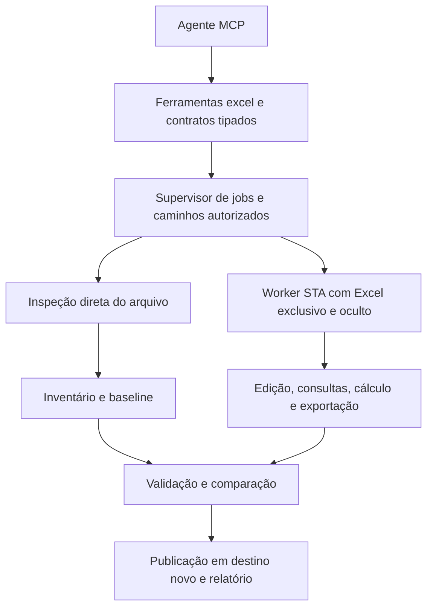

# MCP Excel: leitura, edição, cálculo e validação em background

**Estado:** plano de referência da implementação. **Revisão:** 2026-11-07. As capacidades entregues e seus limites estão no [manual operacional](../mcp-excel.md); o [registro de aceite](../implementation/mcp-excel.md) identifica as provas e o estado de validação. A matriz pretendida deste plano não substitui o catálogo efetivamente publicado pelo MCP.

**Premissa confirmada pelo usuário:** o modo avançado pode exigir Windows com Excel desktop instalado e ativado, executando oculto na sessão do usuário. Não abrir documentos no Excel visível nem usar cliques, teclado ou automação da interface para operá-los.

## Objetivo e decisões propostas

Criar o módulo `excel.*` no MCP stdio do Onmyōji para inspecionar, navegar, editar, validar, atualizar e exportar pastas de trabalho locais. A prioridade é a fidelidade ao Excel atual, incluindo fórmulas modernas, VBA, tabelas, tabelas dinâmicas, gráficos, consultas e modelo de dados, dentro das APIs públicas efetivamente disponíveis.

O backend principal será o próprio Excel desktop, acessado por COM com `pywin32`, em processo exclusivo e oculto. Um componente de leitura do pacote OOXML complementará o inventário, a leitura de valores salvos e a verificação de preservação, sem regravar indiscriminadamente o arquivo. O Excel fará as alterações de pastas existentes e o cálculo nativo. Essa combinação evita desenvolver um motor de fórmulas incompatível com a aplicação de destino.

| Decisão | Efeito no contrato |
| --- | --- |
| Excel nativo como backend principal | Compatibilidade depende de versão, build, canal, arquitetura, licença, suplementos e serviços instalados |
| Instância exclusiva do MCP | Não anexar ao Excel do usuário nem alterar suas opções, arquivos ou cálculo |
| Operações por referências explícitas | Navegação por aba, intervalo e objeto; sem depender de célula ativa, seleção ou foco |
| Trabalho em cópia e publicação em destino novo | Falha não altera a fonte; conversões e remoções de recursos são explícitas |
| Jobs e alterações em lote | MCP continua responsivo e cada solicitação tem progresso, cancelamento e resultado verificável |
| Capacidades por operação e arquivo | Distinguir ler, preservar, criar, editar, executar, atualizar e validar um recurso |
| Extensão pelo modelo de objetos | Recursos adicionais ganham adaptadores sem exigir uma ferramenta separada para cada membro COM |

> [!IMPORTANT]
> “Todos os recursos” é uma direção de cobertura, não uma garantia universal. Um recurso presente na interface pode não ter API pública ou depender de autenticação, suplemento ou serviço externo. O MCP deve expor a limitação antes de editar e recusar perda silenciosa. O [modelo de objetos oficial](https://learn.microsoft.com/en-us/office/vba/api/overview/excel/object-model) orienta a cobertura; cada operação ainda precisa de homologação.

## Execução oculta e dependência de sessão

O MCP documental atual pode funcionar sem o daemon. Manter essa propriedade: o servidor MCP gerencia o supervisor e inicia o worker Excel no contexto do usuário conectado. Não cadastrar o Excel como serviço do Windows nem iniciá-lo em Session 0. Se o MCP estiver em contexto incompatível, o backend nativo fica indisponível com diagnóstico; um executor em sessão de usuário, caso necessário futuramente, será uma integração explícita com IPC local autenticado.

`Application.Visible = False` oculta a aplicação. A Microsoft alerta que automação Office não interativa pode travar e solicitar interação, inclusive em cenários unattended. A escolha por sessão de usuário reduz a distância do ambiente desktop, mas não elimina esses limites. Ver [Visible](https://learn.microsoft.com/en-us/office/vba/api/excel.application.visible) e [considerações oficiais sobre automação unattended](https://learn.microsoft.com/en-us/office/client-developer/integration/considerations-unattended-automation-office-microsoft-365-for-unattended-rpa).

O worker deve:

1. Inicializar COM em STA e criar uma instância nova, inicialmente com `DispatchEx`/ativação equivalente a homologar. Nunca usar `GetActiveObject` para aproveitar uma sessão aberta.
2. Comprovar exclusividade e propriedade da instância por HWND, PID, instante de criação, executável e contexto de execução. Não considerar `DispatchEx`, isoladamente, prova suficiente de isolamento.
3. Definir `Visible=False`, `DisplayAlerts=False`, `ScreenUpdating=False`, `EnableEvents=False`, `AskToUpdateLinks=False` e a política de macros antes de abrir qualquer documento. Não restaurar uma política permissiva durante aberturas subsequentes.
4. Preparar cálculo manual e `CalculateBeforeSave=False` antes de abrir o documento alvo. Homologar o momento dessa configuração: se necessário, criar primeiro uma pasta sintética neutra do executor e mantê-la como primeira pasta da instância. Revalidar o modo após cada abertura, sem depender do modo salvo na fonte.
5. Abrir somente cópias autorizadas por `Workbooks.Open`, com parâmetros explícitos, incluindo atualização de links desativada e ausência de inclusão nos arquivos recentes. Não chamar `Select`, `Activate`, `SendKeys`, diálogos ou comandos de Ribbon.
6. Serializar as chamadas COM na thread proprietária. Aguardar mensagens COM quando necessário; não compartilhar proxies COM entre threads/processos.
7. Usar supervisor externo para deadline, memória, processo morto e chamadas COM bloqueadas. Aplicar tentativas limitadas a rejeições transitórias de chamada; não repetir mutações cujo efeito seja incerto.
8. Fechar as pastas e chamar `Quit` no encerramento normal. Em timeout, atuar apenas sobre processos cuja propriedade esteja comprovada. Nunca executar encerramento por nome, como matar todos os `EXCEL.EXE`.

Começar com uma instância ativa por contexto de usuário e uma fila compartilhada entre perfis/processos MCP. Limitar o tempo de vida ao job e reciclar o processo entre trabalhos. Paralelismo entre instâncias Excel exige homologação específica; não presumir isolamento completo de suplementos e recursos globais só porque os PIDs diferem.

Concretizar essa exclusão com mutex Windows nomeado por identidade/sessão do executor, associado ao diário de posse/recuperação. Um lock Python intraprocesso não coordena duas sessões MCP; liberação de mutex abandonado exige reconciliar o processo Excel anterior antes de iniciar outro.

> [!NOTE]
> Decisão operacional da implementação: a fila pertence a um supervisor exclusivo por diretório/perfil. Outro servidor MCP recebe `profile_busy` enquanto essa reserva estiver ativa. O mutex Windows serializa o Excel também entre supervisores de perfis diferentes. Compartilhar a mesma fila entre vários servidores MCP exige uma coordenação adicional; não é uma capacidade anunciada pelo módulo entregue. A reserva impede que um servidor reconcilie indevidamente os jobs ativos de outro.

> [!WARNING]
> `Visible=False` e `DisplayAlerts=False` não garantem ausência absoluta de janelas: avisos de segurança, autenticação, suplementos e macros podem abrir diálogos. Detectar condição bloqueante e abortar, sem recorrer à operação visual. A detecção posterior não garante que nenhum diálogo apareceu brevemente. Se a exigência incluir isolamento absoluto da área de trabalho mesmo nesses casos, usar sessão/VM dedicada, separada do desktop do usuário. Execução de VBA arbitrário não pode prometer invisibilidade absoluta na mesma sessão.

## Componentes e fluxo



| Componente | Responsabilidade |
| --- | --- |
| Registro/fachada MCP | Schemas fechados, seleção de perfil, operações disponíveis e despacho sem bloquear o event loop |
| Supervisor | Fila global do executor, jobs, idempotência, limites, cancelamento, posse de processos e recuperação |
| Inspeção de arquivo | Identificar formato/conteúdo, inventariar OOXML, ler fórmulas e caches salvos, detectar recursos que condicionam a abertura |
| Sessão Excel | Ciclo de vida COM, abertura controlada, configuração, referências explícitas e encerramento |
| Serviços funcionais | Intervalos, fórmulas, tabelas, pivôs, apresentação, VBA, consultas e modelo de dados |
| Validação/publicação | Conferir contrato solicitado, resultados, preservação e publicação dos artefatos |
| Repositório de jobs | Estado, fingerprints, relatórios e recuperação; sem persistir proxies COM |

### Por que não usar somente bibliotecas de arquivo

`openpyxl` pode auxiliar leituras específicas, mas não será o editor universal nem o motor de cálculo: sua documentação registra que não avalia fórmulas, que `keep_vba` preserva elementos sem editá-los e que certos objetos podem ser perdidos numa regravação. Ver [fórmulas](https://openpyxl.readthedocs.io/en/stable/simple_formulae.html) e [carregamento/preservação](https://openpyxl.readthedocs.io/en/stable/tutorial.html). Não fazer uma rodada `load/save` por essa biblioteca depois de uma edição nativa.

Graph e Office Scripts podem ser backends opcionais futuros para acervos cloud, mas não são a base deste projeto local: há diferenças de cobertura em relação ao VBA desktop e restrições de atualização no Power Automate. Ver [comparação VBA/Office Scripts](https://learn.microsoft.com/en-us/office/dev/scripts/resources/vba-differences) e [limitações de atualização](https://learn.microsoft.com/en-us/office/dev/scripts/testing/power-automate-troubleshooting). Não adotar outro aplicativo de planilhas como substituto silencioso do cálculo Excel.

## Matriz de cobertura pretendida

As linhas abaixo são escopo de implementação e homologação. “Nativo” identifica a rota proposta, sem afirmar que todos os detalhes da família estejam implementados. A matriz publicada pelo MCP deve ter granularidade maior que esta tabela.

| Família | Operações pretendidas | Rota e limites |
| --- | --- | --- |
| Pastas e abas | Criar, abrir cópia, inventariar, renomear, reordenar, duplicar, mover/copiar abas, ocultar e proteger | Nativo; distinguir worksheets, chartsheets e tipos legados |
| Navegação | Listar abas/objetos, localizar tabela/nome/região, descrever cabeçalhos, paginação e busca | Sem mover cursor; UsedRange pode conter apenas formatação e não define sozinho a área de dados |
| Células e intervalos | Ler/gravar matrizes, limpar conteúdo/formato, inserir/excluir, copiar/colar, transpor, preencher, ordenar e mesclar | Nativo; operações em bloco; declarar comportamento de referências e conteúdo sobrescrito |
| Fórmulas e nomes | A1/R1C1, referências estruturadas, nomes locais/globais, arrays legados/dinâmicos, LET/LAMBDA e funções disponíveis | `Formula2` para arrays modernos, interfaces específicas para fórmulas legadas; funções detectadas no build |
| Formatação | Fontes, preenchimentos, bordas, alinhamento, formatos numéricos, temas, estilos e dimensões | Nativo; rich text e cores temáticas precisam de testes próprios |
| Formatação condicional | Criar/editar regras, prioridade, stop-if-true, escalas, barras e ícones | Nativo, respeitando diferenças entre tipos de regra |
| Validação de dados | Lista, número, data, texto, fórmula personalizada, mensagens e alertas | Configurar regra e também auditar valores já existentes; gravação por API não substitui auditoria |
| Tabelas estruturadas | Criar/redimensionar, colunas calculadas, totais, estilos, anexar linhas e converter em intervalo | `ListObject`; tratar cabeçalho vazio/duplicado e propagação de fórmula |
| Filtros e organização | AutoFilter simples/avançado, múltiplos critérios, datas, cores, valores visíveis, grupos e subtotais | Separar linhas ocultas manualmente de linhas filtradas |
| Tabelas dinâmicas | Criar, alterar origem/campos/agregações/layout, filtros, agrupamento, caches, refresh e drill-down | Distinguir pivôs tradicionais de OLAP/Data Model; campos calculados e medidas têm contratos distintos |
| Segmentações e timelines | Criar/configurar conexões e seleção, consultar estado e atualizar | APIs de slicers/cache, conforme origem e suporte do build |
| Gráficos e minigráficos | Criar/editar tipo, séries, eixos, títulos, rótulos, legenda, combinação e PivotChart | Nativo; tipos modernos e exportação de imagem homologados por tipo |
| Objetos visuais | Imagens, shapes, caixas de texto, posicionamento, tamanho e hyperlinks | Inventariar e preservar; edição conforme API; objetos OLE não são executados para inspeção |
| Controles | Controles de formulário, ações associadas e propriedades expostas de controles incorporados | Separar controles de formulário de ActiveX; inventário/preservação não autoriza ativação ou execução, e políticas do Office podem impedir o recurso |
| Notas e comentários | Ler/editar notas e comentários encadeados onde expostos | Identidade/autoria e capacidades distintas; não enviar menções ou notificações implicitamente |
| Exibição e impressão | Congelamento, zoom, áreas/títulos de impressão, cabeçalhos, rodapés, quebras e configuração de página | Pode depender de janela interna/impressora; homologar em modo oculto, sem tornar Excel visível |
| Exportação | PDF, CSV/TSV, JSON de dados, imagens de gráficos e conversões entre formatos | Destino, seleção, encoding e perdas explícitos; imagem de intervalo depende de rota oculta homologada |
| VBA | Listar módulos/referências, ler fonte, editar, importar/exportar e remover módulos | VBIDE, acesso confiável habilitado e projeto acessível; UserForms incluem recursos `.frx` |
| Execução VBA/UDF | Executar procedimento e calcular com funções VBA quando habilitado | Perfil e operação separados; não executar eventos automaticamente para simular abertura manual |
| Power Query e conexões | Listar/criar/editar consultas M e parâmetros, mapear destinos, atualizar e conferir status | `Workbook.Queries`, `WorkbookQuery.Formula`, conexões e QueryTables; depende de conectores/credenciais |
| Data Model e DAX | Inventariar tabelas, relacionamentos e medidas; criar/editar itens expostos; atualizar | API pública parcial; não assumir equivalência com toda a interface Power Pivot |
| Cálculo e simulação | Incremental, completo, reconstrução, iteração, tabelas de hipóteses, Goal Seek e cenários | Recurso homologado por operação; Solver e funções de suplementos dependem do componente instalado |
| Proteção e segurança do arquivo | Detectar proteção/criptografia/assinaturas e operar com senha/certificado autorizado | Sem contornar proteções; distinção entre proteção de aba, senha de abertura e assinatura |
| Recursos conectados | Tipos de dados vinculados, Python in Excel, RTD, CUBE, funções web e suplementos | Disponibilidade/atualização específicas; sem garantia offline ou prova de atualização universal |
| Colaboração e recursos novos | Preservar e inventariar coautoria, vínculos cloud, controles e extensões detectáveis | Copilot, histórico remoto e recursos sem API pública não recebem suporte presumido |

Referências para recursos avançados: [Formula2](https://learn.microsoft.com/en-us/office/vba/api/excel.range.formula2), [Queries](https://learn.microsoft.com/en-us/office/vba/api/excel.workbook.queries), [fórmula M](https://learn.microsoft.com/en-us/office/vba/api/excel.workbookquery.formula), [Model](https://learn.microsoft.com/en-us/office/vba/api/excel.model), [medidas DAX](https://learn.microsoft.com/en-us/office/vba/api/excel.modelmeasures.add) e [SlicerCaches.Add](https://learn.microsoft.com/en-us/office/vba/api/excel.slicercaches.add).

### Formatos

| Formato | Contrato pretendido |
| --- | --- |
| `.xlsx`, `.xlsm` | Prioridade inicial: inspeção direta do pacote, edição nativa e validação; `.xlsx` não recebe código VBA |
| `.xlsb` | Leitura/edição/cálculo nativos após homologação do preflight binário e da preservação; não passar por parser OOXML XML |
| `.xls` | Compatibilidade legada explícita, com limites do formato; detectar macros XLM antes de abrir pelo backend nativo |
| `.xltx`, `.xltm`, `.xlt` | Distinguir editar modelo de criar uma pasta a partir dele; não alterar o modelo implicitamente |
| `.xlam`, `.xla` | Inventário/preservação e edição VBA quando viáveis; carregar suplemento é execução e exige política específica |
| `.csv`, `.tsv`, texto | Dados tabulares, com delimitador/encoding/tipos explícitos; não representam os recursos de uma pasta Excel |
| Arquivo criptografado ou protegido por direitos | Detectar antes da abertura; requer credencial e backend compatível, ou retornar bloqueio explicável |

Identificar formato pelo conteúdo, não apenas pela extensão. OOXML criptografado não pode ser presumido ZIP inspecionável. Quando o preflight não conseguir verificar conteúdo ativo em um formato, não anunciar abertura segura: bloquear ou exigir um perfil de conteúdo confiável especificamente habilitado. Conversões para formatos com menor capacidade devem apresentar perdas previstas antes da execução e verificá-las no resultado.

## Contratos de dados, fórmulas e navegação

Leitura deve distinguir valor bruto, fórmula, valor calculado salvo, texto exibido, erro, tipo e origem da leitura. No modo direto, um cache existente não prova que a pasta está atualizada; retornar `freshness: unknown` ou `saved_cache`, nunca `calculated` sem cálculo observado.

Entradas de escrita devem diferenciar `value`, `formula` e `clear`. Texto iniciado por `=` não vira fórmula sem indicação de tipo. Distinguir célula vazia, string vazia, zero, booleano, erro e número; preservar identificadores longos como texto quando solicitado. Datas consideram o sistema 1900/1904 e a semântica própria do Excel, sem impor um timezone a valores que não o têm.

Fórmulas usam linguagem invariável por padrão, com entrada localizada opcional declarada. Não traduzir funções/separadores com substituição textual. Expor a fórmula original e a representação solicitada; tratar interseção implícita `@`, referências de spill `#`, arrays legados, células mescladas e colunas calculadas antes de escrever. `Formula2` não implica que toda função recente esteja disponível.

Referências devem incluir pasta, aba e alvo. Aceitar A1, nomes e tabelas com resolução explícita de escopo; R1C1 exige base quando houver referência relativa. Não aceitar expressões arbitrárias para avaliação pelo Python. Copiar/mover deve usar semântica nativa de atualização de referências e apresentar o alcance afetado.

Leituras grandes precisam de paginação, seleção de campos, limites de células/bytes e exportação de resultado para arquivo. As páginas pertencem ao mesmo snapshot identificado por hash; mudanças na fonte invalidam a continuação. A leitura de células visíveis informa filtros e ocultação considerados. Escrita por blocos evita uma chamada COM por célula.

## Cálculo, atualização e persistência

São operações diferentes: calcular fórmulas, atualizar fontes externas, atualizar pivôs e executar VBA. O pedido deve dizer quais etapas pretende e o relatório deve mostrar o estado de cada uma.

| Operação | Comportamento proposto |
| --- | --- |
| `recalculate`, modo `incremental` | Executar o cálculo nativo aplicável às dependências alteradas |
| `recalculate`, modo `full` | Recalcular todas as fórmulas da instância exclusiva |
| `recalculate`, modo `full_rebuild` | Recalcular e reconstruir dependências com `CalculateFullRebuild` |
| `refresh` | Atualizar fontes selecionadas, conexões e/ou pivôs, verificando cada alvo |
| Pipeline de atualização | Resolver fontes e dependências autorizadas, atualizar dados/modelo, calcular fontes de pivôs, atualizar caches/pivôs e calcular dependentes finais |
| `calculate_on_open` | Ajustar sinalizadores de cálculo futuro; não alegar que isso já atualizou os valores salvos |

Controlar também cálculo involuntário ao abrir, salvar ou reabrir para verificação. O Excel herda o modo da primeira pasta da instância, e o modo vigente pode ser salvo nos documentos; `CalculateBeforeSave` é uma opção adicional. Registrar as opções originais e definir a saída como `preserve` por padrão, ou modo explicitamente solicitado. A restauração não pode disparar cálculo extra depois da validação sem que ele seja observado e revalidado; combinações sem rota comprovada ficam bloqueadas. Ver [modo de cálculo](https://learn.microsoft.com/en-us/troubleshoot/microsoft-365-apps/excel/current-mode-of-calculation) e [CalculateBeforeSave](https://learn.microsoft.com/en-us/office/vba/api/excel.application.calculatebeforesave).

Fixar `Workbooks.Open` como rota de abertura: a documentação de [QueryTable.RefreshOnFileOpen](https://learn.microsoft.com/en-us/office/vba/api/excel.querytable.refreshonfileopen) e [OLEDBConnection.RefreshOnFileOpen](https://learn.microsoft.com/en-us/office/vba/api/excel.oledbconnection.refreshonfileopen) informa que esses objetos não fazem refresh automático nessa rota. Homologar esse comportamento por conector/build e não extrapolar a garantia para todos os serviços, suplementos ou recursos conectados. Se não for possível impedir uma atualização não solicitada, a leitura nativa daquele recurso deve ser bloqueada ou depender de política explícita.

Para entregar uma pasta já calculada: editar a cópia, executar as etapas solicitadas, esperar conclusão observável, conferir os resultados, salvar, fechar e reabrir ocultamente em modo de verificação. A verificação deve impedir novo cálculo/refresh automático que mascare caches não persistidos; para OOXML, conferir também valores salvos diretamente no pacote. Relatar limites da prova em outros formatos.

[`CalculateFullRebuild`](https://learn.microsoft.com/en-us/office/vba/api/excel.application.calculatefullrebuild) atua em todas as pastas da instância. Abrir dependências somente quando autorizadas, mantendo inventário e política de links. Configurar atualização ao abrir é complementar ao cálculo agora, sem substituir sua execução.

> [!IMPORTANT]
> A documentação atual de [`Workbook.RefreshAll`](https://learn.microsoft.com/en-us/office/vba/api/excel.workbook.refreshall) registra que uma consulta Power Query carregada em tabela pode falhar sem lançar erro e manter os dados anteriores. Para esses destinos, atualizar cada `ListObject.QueryTable` com `Refresh(BackgroundQuery=False)` e tratar o retorno/erro individual. Ausência de exceção em `RefreshAll` não prova sucesso.

Para consultas/modelos sem QueryTable, implementar verificação específica por tipo de conexão e declarar `unverified` quando a API não fornecer evidência suficiente. Não executar `RefreshAll` seguido de atualizações individuais redundantes indiscriminadamente: o plano de atualização deve identificar dependências e evitar duplicar consultas com efeitos externos.

`CalculationState == xlDone` cobre o estado de cálculo; [`CalculateUntilAsyncQueriesDone`](https://learn.microsoft.com/en-us/office/vba/api/excel.application.calculateuntilasyncqueriesdone) trata consultas OLEDB/OLAP. Nenhum deles, sozinho, prova que todo serviço, conector, RTD ou fórmula cloud concluiu. Aplicar deadline global e verificação por fonte. Estados contínuos, como RTD, precisam de critério explícito de snapshot.

Erros de célula (`#REF!`, `#DIV/0!`, `#VALUE!`, `#NAME?`, `#SPILL!`, `#CALC!` e equivalentes do build) não significam necessariamente falha da chamada COM. Comparar com o baseline e aplicar critérios da solicitação: ausência de erros novos, intervalos críticos válidos ou erros expressamente esperados. Referências circulares com iteração habilitada também não são falha automática; registrar configuração e resultado.

O relatório deve separar `calculation`, `connections`, `pivots`, `macros` e `persisted_cache`, com estados como `completed`, `failed`, `blocked`, `unverified` e `not_requested`. `completed` significa conclusão observada da etapa, não auditoria do significado dos dados da fonte. Uma etapa exigida e bloqueada/não verificada impede declarar atualização integral; política mais permissiva precisa constar expressamente no pedido.

## VBA: edição e execução

Ler/editar fonte depende do acesso confiável ao modelo de objetos VBA e de projeto acessível. O setup diagnostica esse requisito e explica a configuração administrativa; o MCP não altera silenciosamente Trust Center, registro ou políticas corporativas. Ver [modelo VBIDE](https://learn.microsoft.com/en-us/office/vba/language/reference/visual-basic-add-in-model/objects-visual-basic-add-in-model) e [configurações de segurança de macros](https://support.microsoft.com/en-us/excel/change-macro-security-settings-in-excel).

O inventário contempla módulos padrão, classes, módulos de documento, UserForms e referências, distinguindo referência ausente de componente não suportado. Alterar trecho de código exige baseline/hash da fonte e limites definidos; não usar busca/substituição irrestrita. A importação/exportação preserva atributos e recursos associados, incluindo `.frx`, além de tratar encoding e finais de linha do formato exportado pelo VBIDE.

Não prometer edição visual completa de UserForms nem compilação completa só por ter gravado o `CodeModule`. Validar o que a API permitir, verificar referências e registrar se a compilação foi ou não comprovada. Não acionar comandos do editor VBA pela interface para preencher essa lacuna. Execução de um procedimento de teste autorizado é evidência daquele fluxo, não prova de todos os caminhos do projeto.

Editar um projeto assinado afeta sua assinatura. Detectar e informar a consequência; preservar o original e só oferecer reassinatura se houver certificado apropriado e operação implementada. Ver [assinatura digital de projetos VBA](https://support.microsoft.com/en-us/office/vba/digitally-sign-your-vba-macro-project).

Por padrão, abertura ocorre com macros e eventos desabilitados. [`AutomationSecurity=ForceDisable`](https://learn.microsoft.com/en-us/office/vba/api/excel.application.automationsecurity) não desativa macros Excel 4.0/XLM; o preflight deve detectá-las e bloquear sua abertura nativa nesse perfil. Aplicar o mesmo cuidado a suplementos e outros conteúdos ativos que não sejam abrangidos por essa propriedade.

`run_macro` e cálculo com UDF VBA são capacidades separadas da edição. Exigem perfil habilitado para conteúdo confiável e procedimento/pasta explicitamente selecionados. A execução usa instância nova com política própria e reabertura controlada, sem executar eventos de abertura como efeito colateral. Não repetir uma macro automaticamente após timeout: pode ter alterado arquivos ou serviços externos, e rollback da pasta de trabalho não desfaz esses efeitos. O processo worker não constitui sandbox de VBA.

## Ferramentas MCP propostas

Este catálogo é um contrato inicial a detalhar em schemas, não nomes já publicados. As operações sobre documentos retornam jobs; diagnósticos e consultas de estado respondem diretamente. Preferir ferramentas funcionais e `apply_changes` com operações discriminadas a centenas de ferramentas muito pequenas.

| Ferramenta/família | Finalidade |
| --- | --- |
| `excel.get_capabilities`, `excel.describe_feature` | Consultar ambiente, operações, pré-requisitos, limites e evidência de homologação |
| `excel.inspect`, `excel.navigate` | Inventariar arquivo e localizar abas, regiões, nomes, tabelas e objetos |
| `excel.read_range`, `excel.search` | Ler campos selecionados e localizar valores, fórmulas ou objetos, com paginação |
| `excel.analyze_formulas` | Inspecionar erros e dependências observáveis; indicar referências dinâmicas/externas não resolvidas |
| `excel.apply_changes` | Aplicar lote tipado em cópia: abas, células, fórmulas, estilos, tabelas, filtros, validações, pivôs, gráficos e consultas |
| `excel.recalculate`, `excel.refresh` | Produzir cópia calculada/atualizada e relatório por etapa |
| `excel.validate`, `excel.compare` | Conferir estrutura, regras, resultados e diferenças entre pastas |
| `excel.export` | Produzir arquivos em formatos e seleções explícitos |
| `excel.get_vba_source`, `excel.edit_vba`, `excel.run_macro` | Separar leitura, edição e execução de código |
| `excel.describe_object`, `excel.get_object`, `excel.set_object`, `excel.call_object` | Extensão controlada para membros públicos homologados do modelo de objetos |
| `excel.get_job`, `excel.get_job_result`, `excel.cancel_job`, `excel.list_jobs` | Progresso, resultado paginado, cancelamento e histórico |
| `excel.list_profiles` | Descobrir perfis quando houver mais de um habilitado |

Todos os schemas são fechados, com tipos e limites por operação, sem `kwargs` arbitrários. No MVP, usar jobs sem sessão pública persistente: cada chamada recebe o arquivo/snapshot e as alterações correlatas ficam no mesmo lote. Isso evita estado invisível entre turnos e processos Excel abandonados. Sessões temporárias podem ser avaliadas depois, com TTL, revisão e commit explícito, se medições demonstrarem necessidade.

A extensão de objetos resolve seletores estruturados a partir da pasta do job, com membros/tipos autorizados e verificações equivalentes às ferramentas funcionais. Não oferecer Python, PowerShell ou avaliação COM arbitrária. Bloquear membros que abram UI, iniciem DDE/OLE, executem código por outra rota, mudem opções globais ou alcancem caminhos externos às permissões. A existência de um membro no type library não comprova segurança, fidelidade ou suporte oculto; adaptadores novos precisam de schema e homologação.

### Exemplo de lote e política de cálculo

Exemplo ilustrativo do futuro `excel.apply_changes`; o caminho representa o workspace externo da instância:

```json
{
  "input_path": "C:/Work/entrada/relatorio.xlsm",
  "output_path": "C:/Work/saida/relatorio-atualizado.xlsm",
  "request_id": "relatorio-revisao-001",
  "confirm": true,
  "operations": [
    {"type": "set_values", "sheet": "Premissas", "range": "B2", "values": [[0.12]]},
    {"type": "set_formula", "sheet": "Resumo", "range": "D2", "formula": "=SUM(Vendas[Valor])", "notation": "A1", "language": "invariant"}
  ],
  "calculation": {"mode": "full_rebuild", "refresh_connections": false},
  "validation": {"reject_new_formula_errors": true}
}
```

`confirm=true` segue o contrato das operações documentais existentes; é um argumento do protocolo para executar a escrita solicitada, não uma exigência de nova confirmação conversacional a cada chamada já autorizada. Execução de código e atualização externa têm suas próprias permissões administrativas.

### Capacidade verificável

Para cada recurso/ação, expor pelo menos `supported`, `available`, `verified`, `reason`, `prerequisites` e o ambiente onde houve verificação. `supported` significa que há implementação; `available`, que os pré-requisitos atuais permitem a ação; `verified`, que houve teste compatível com a combinação de ambiente/recurso. Ser legível não implica ser editável.

Diagnóstico estático identifica sistema e dependências sem abrir Excel. Um probe nativo explícito pode iniciar a instância oculta e um documento descartável, informando que o fez. Registrar versão/build, arquitetura e capacidades detectáveis; canal/licença só quando identificáveis, usando `unknown` quando não houver prova. `Application.Version` isoladamente não distingue todos os canais modernos. Não inventariar conteúdo pessoal nem carregar suplementos para “testar” sem configuração.

## Validação e preservação

| Camada | O que deve comprovar |
| --- | --- |
| Entrada | Formato real, integridade de container, limites, caminhos, criptografia, conteúdo ativo e pré-requisitos |
| Estrutural | Partes/relações OOXML aplicáveis ou abertura nativa do formato; regras de aba, nomes, tabelas e referências |
| Operação | Pós-condições do pedido: células, fórmulas, estilos, objetos e intervalos afetados |
| Dados | Violações de validação, tipos, obrigatoriedade, unicidade, limites e reconciliações configuradas pelo solicitante |
| Cálculo/refresh | Estados observados, falhas por conexão, erros novos e resultados críticos esperados |
| Preservação | Comparação do inventário anterior/posterior, módulos, objetos, vínculos, extensões e partes não editadas |
| Persistência | Arquivo salvo reaberto sem reparo, resultados necessários persistidos e artefatos publicáveis |

O Excel pode normalizar XML e metadados ao salvar. Não exigir igualdade binária de todo o arquivo nem confundi-la com equivalência funcional. Comparar semanticamente o conteúdo conhecido e acompanhar partes opacas por manifestos/hashes; mudança opaca inexplicada gera preservação não verificada, não sucesso presumido. A política estrita impede publicação quando um requisito de preservação não foi comprovado.

Validação de schema OOXML, se implementada, é evidência estrutural e não prova cálculo ou equivalência visual. Arquivos binários, extensões modernas, modelo de dados e proteções têm evidências próprias. Falhas de reparo/compatibilidade nunca devem ser aceitas silenciosamente. Exportações visuais precisam de verificação de layout no corpus de homologação, incluindo dependências de fontes e impressora.

Um relatório deve conter hash da fonte e da saída, versão do contrato, backend/build usados, operações executadas, diferenças relevantes, contagem de problemas, verificações realizadas e verificações pendentes. Retornar amostras paginadas e arquivo de relatório para casos grandes. Não registrar células, fórmulas, código VBA, senhas ou strings de conexão nos logs por padrão.

## Jobs, publicação e recuperação

Reutilizar a experiência de `document_processing` para idempotência, autorização de caminhos, staging e resultados. O código atual restringe explicitamente os namespaces a `pdf`/`ocr`; não basta cadastrar `excel` numa subclasse. Inicialmente manter supervisor Excel específico e compartilhar somente componentes cujo contrato seja compatível. Generalização posterior deve preservar os testes e contratos existentes.

Cada solicitação usa `request_id`, perfil, argumentos normalizados, fingerprint da fonte e versão das políticas relevantes. Mesma chave com conteúdo/argumentos diferentes é conflito. Repetir consulta ao job não repete edição, macro ou atualização externa. Atualização de conteúdo volátil requer novo pedido quando se deseja novo resultado.

Estados de job: `queued`, `running`, `succeeded`, `failed`, `cancelled`, `interrupted`. Progresso inclui etapa, alvo e contagem quando mensurável, sem percentual fictício. O resultado contém os estados específicos de cálculo/refresh/validação e eventuais pendências. Sucesso do job só ocorre após as verificações exigidas e a publicação completa.

A transação abrange os artefatos publicados pelo MCP. Preparar cópia de trabalho, verificar fonte e destino contra alterações concorrentes, salvar/fechar, validar e publicar sem sobrescrever arquivos existentes. Para vários artefatos, usar manifesto de conclusão e recuperação, sem prometer atomicidade de todo o conjunto entre volumes. Não abrir a fonte original em modo de escrita. Mudanças externas executadas por macro/consulta não participam desse rollback.

### Semântica de caminho e nome do arquivo

Staging e destino novo podem mudar vínculos relativos e resultados dependentes da localização, como `CELL("filename")`, `ThisWorkbook.Path` e `ThisWorkbook.FullName`. Manter separadas a origem lógica, a cópia de execução e a localização final; resolver dependências relativas com base declarada e nunca tomar a pasta de staging como origem implícita.

A pasta entregue deve refletir a localização final quando isso fizer parte do cálculo solicitado. A prova inicial precisa incluir um caso dependente de caminho e definir uma rota de finalização compatível com validação e publicação; renomear o arquivo depois de calcular não é prova suficiente. Até haver essa rota, bloquear operações detectadas/declaradas como sensíveis a caminho que não possam ser preservadas. A análise estática de VBA/fórmulas não garante detectar todos esses casos; o relatório deve indicar essa limitação, em especial com macros arbitrárias.

### Recuperação e erros

Ao reiniciar, reconciliar jobs incompletos e marcar `interrupted`; não reexecutá-los automaticamente. Limpar somente diretórios e processos próprios, com validação de identidade. Excel iniciado por COM pode não ser descendente do worker: um Job Object configurado só para o worker não prova que a instância Excel será encerrada. Recuperação deve cobrir também queda do MCP, do worker e do próprio Excel.

Erros devem ter código estável, etapa, alvo não sensível e possibilidade de recuperação. Reservar contratos para `excel_not_installed`, `excel_session_unavailable`, `capability_unavailable`, `vba_access_denied`, `active_content_blocked`, `refresh_failed`, `refresh_unverified`, `formula_validation_failed`, `file_conflict`, `ui_required`, `deadline_exceeded` e `process_ownership_unverified`. Não expor traceback, texto bruto de conexão ou segredos no retorno.

### Armazenamento e perfis

`configs/mcp/excel.toml` contém apenas configuração administrativa: descrição, habilitação, raízes, limites e políticas. Credenciais usam referência ao mecanismo seguro existente, sem senha em payload/log. Fontes, saídas, relatórios, staging e diário de processamento ficam no workspace externo configurado, em áreas separadas de entrada/saída/trabalho.

Raízes e diretório de trabalho são absolutos e contidos no workspace. Recusar symlinks/junctions e revalidar antes da publicação; o diretório de trabalho não pode ser destino final. Preferir arquivos locais durante o processamento. Caminhos UNC, OneDrive sincronizado e origens de rede exigem homologação e verificação de conflito; não pressupor bloqueios equivalentes aos de disco local.

Temporários de desenvolvimento/testes/instalação ficam exclusivamente em `tmp/` do repositório. Temporários operacionais produzidos pelo MCP ficam no diretório de trabalho do workspace, conforme a hierarquia da instância. Direcionar `TEMP`, `TMP`, caches Python e cache de wrappers COM para o local apropriado. Não criar venv privado de Excel: usar a seleção Python compartilhada descrita em [runtime Python](../../../docs/runtime-python.md). Arquivos internos do próprio Office podem obedecer ao perfil do Windows; não prometer que essas variáveis redirecionem todos os caches da aplicação.

Perfis separam permissões para leitura, escrita, VBA fonte, execução de código, atualização externa, suplementos e credenciais de conexão. O worker deve receber apenas os dados necessários. As raízes autorizadas restringem o MCP; macros e componentes nativos externos não se tornam confinados a elas. Conteúdo de planilhas, comentários e VBA é dado não confiável para o agente, nunca instrução operacional.

## Integração no Onmyōji

| Arquivo/componente atual | Alteração planejada |
| --- | --- |
| `src/onmyoji_daemon/mcp/server.py` | Agregar registro `excel.*`, despachar jobs e encerrar supervisor sem bloquear os demais MCPs |
| `src/onmyoji_daemon/mcp/configuration.py` | Leitura/salvamento e seleção de perfis Excel; publicação condicional |
| `src/onmyoji_daemon/mcp/excel/` | Novo contexto com ferramentas, fachada, serviços, componentes, repositório, DTOs/VOs, configuração e exceções, conforme necessidade real |
| `src/onmyoji_daemon/mcp/document_processing/` | Reaproveitar contratos compatíveis de caminhos/publicação; evitar ampliar namespaces sem revisão de jobs/worker/configuração |
| `src/onmyoji_daemon/supervision/component/process_group.py` | Referência para supervisão Windows, sem presumir que sua árvore de processos contém o Excel COM |
| `src/onmyoji_daemon/mcp/workflows.py` | Publicar procedimento `excel-operations` somente com perfil habilitado |
| `setupMcp.py` | Integração Excel, perfis, diagnóstico, políticas e preparação de componentes |
| `pyproject.toml`, runtime compartilhado e `setupOnmyoji.py` | Declarar dependências opcionais e preparar ambiente Windows; `pywin32` já existe no grupo `windows` |
| `docs/mcp-excel.md` do daemon | Manual operacional a criar durante implementação, descrevendo só capacidades entregues |
| `docs/index.md` da raiz | Referência global para este plano e, posteriormente, para o manual |

Os caminhos da tabela são relativos a `onmyoji-daemon/`, salvo indicação contrária. Organizar pacotes por finalidade, sem `util`/`common` genéricos. O setup deve seguir [as convenções de interação](../../../docs/setup-interface.md): moldura somente para menus navegáveis, roteiros em fluxo, opções numéricas, padrão explícito e `X` para cancelar/voltar.

Novos documentos de definição de workflow/skill e alterações de `README.md`, `AGENTS.md` ou definições de skill devem observar o fluxo de proposta aplicável. Este plano não modifica esses arquivos nem autoriza alterações de instruções. Não criar workflows ou dependências operacionais em `.github/`.

## Entregas e critérios de passagem

Não estimar todo o desenvolvimento antes de homologar o executor nativo. Cada etapa deve resultar em capacidades demonstráveis; as ferramentas só anunciam ações implementadas e verificadas no escopo correspondente.

| Etapa | Entrega | Critério para avançar |
| --- | --- | --- |
| 0 — Prova do executor | Instância oculta, cópia, escrita, `Formula2`, rebuild, salvamento, reabertura e encerramento; ambiente identificado | Resultado persistido correto, fonte preservada, nenhuma interferência no Excel do usuário e recuperação após timeout/crash |
| 1 — Fundação MCP | Perfis, capacidades, caminhos, supervisor, jobs, idempotência, publicação, configuração e diagnóstico | Testes stdio reais; dependência opcional ausente não quebra outros módulos; nenhum processo órfão nos casos homologados |
| 2 — Leitura e edição | Inventário, navegação, buscas, leitura paginada, lotes, abas, nomes, fórmulas, estilos, tabelas, filtros e validações | Corpus `.xlsx`/`.xlsm` preservado, contratos de dados exercitados e erro de fórmula novo detectado |
| 3 — VBA | Fonte, edição/importação/exportação, referências e assinatura; execução/UDF como capacidades separadas | Projeto sem trust/protegido diagnosticado, fonte validada, XLM tratado antes da abertura e macro interrompida sem repetição automática |
| 4 — Análise e apresentação | Pivôs, caches, slicers/timelines, gráficos, comentários, impressão e exportações | Atualização verificável por objeto, preservação e saídas visuais homologadas em modo oculto |
| 5 — Integrações de dados | Consultas M, conexões, modelo/relacionamentos/medidas DAX e pipeline de refresh | Falha de consulta não vira sucesso com dados antigos; credenciais/serviços ausentes têm estados claros |
| 6 — Ampliação de cobertura | Formatos binários/modelos/suplementos, extensão controlada de objetos e recursos modernos adicionais | Matriz de ações por recurso/build publicada; perdas/limites explícitos e regressão local aprovada |

Fidelidade, validação e recuperação acompanham todas as etapas; não ficam adiadas para a etapa 6. Os marcos representam prioridades, não uma dispensa dos recursos avançados solicitados. A conclusão do escopo avançado exige as etapas aplicáveis e uma matriz final de cobertura/limitações.

### Testes e aceite

Testes de contrato e unidade independem de Excel instalado. Exercitar nulos, tipos inválidos, limites, casos válidos, concorrência e falhas; cobrir integralmente componentes unitários isoláveis conforme as diretrizes do projeto. Integração real é opt-in em Windows com Excel ativado e gera evidência do build testado. Não simular COM e apresentar isso como prova de fidelidade nativa.

| Grupo | Casos críticos |
| --- | --- |
| Ocultação e isolamento | Iniciar com Excel visível do usuário já aberto; conferir suas janelas, documentos, processos e configurações antes/depois, incluindo timeout e queda do MCP |
| Processos e concorrência | Duas sessões MCP/perfis disputando executor; PID reutilizado; rejeição COM transitória; worker/Excel morto; cancelamento durante cálculo/salvamento |
| Tipos e fórmulas | Nulos/vazios, acentos, identificadores longos, datas 1900/1904, pt-BR/invariável, spill bloqueado, LAMBDA, fórmulas legadas, erros prévios/novos e iteração |
| Recursos | Tabelas, filtros/linhas ocultas, validações preexistentes violadas, pivôs tradicionais/OLAP, slicers, gráficos, shapes, comentários e objetos não editados |
| Atualização | Refresh síncrono/assíncrono, Power Query falhando com dados antigos, modelo sem QueryTable, credencial ausente, link quebrado, conector offline e resultado não verificável |
| VBA e formatos | Sem trust, projeto protegido, referências ausentes, assinatura afetada, UserForm com `.frx`, UDF, macro com efeito externo e XLM em formatos admitidos |
| Arquivos e publicação | Criptografado/corrompido, extensão enganosa, arquivo bloqueado, destino existente, fonte mudando, falha de disco, caminhos com junction e preservação do original |
| Resultado persistido | Reabrir sem recalcular, controlar cálculo antes de salvar e modo herdado, conferir caches/resultados, testar vínculos relativos/fórmulas dependentes de caminho e relatar alterações opacas ou perdas de conversão |

Usar `tmp_path`/`TemporaryDirectory` já configurados para `tmp/` e executar `python -B -m pytest`. Não escrever planilhas reais, credenciais, relatórios de clientes ou caches de teste nas fontes versionadas. Corpus sintético controlado deve representar recursos reais; conteúdos binários grandes podem ser gerados para teste em `tmp/`.

Referências locais de testes: `tests/test_mcp_documents.py`, `tests/test_mcp_documents_stdio.py`, `tests/test_mcp_server.py`, `tests/test_mcp_configuration.py`, `tests/test_mcp_runtime.py` e `tests/test_mcp_setup.py`, dentro do daemon; integração do setup também possui testes na raiz. Nenhum teste de escrita/execução deve usar documentos de trabalho do usuário como fixture.

## Roteiro inicial preservado como referência

O roteiro inicial previa executar a etapa 0 em arquivos sintéticos no `tmp/`, sem modificar configuração global do Excel nem documentos do usuário. A prova deveria registrar instância exclusiva oculta, cálculo persistido, preservação de `.xlsm`, edição VBIDE condicionada ao trust, consulta que falha e encerramento após bloqueio, antes de fixar a primeira matriz de capacidades e os schemas da etapa 1. Os resultados atuais pertencem ao registro de aceite, evitando duplicar evidências neste plano.

Pontos que orientaram a prova: comportamento de janelas/suplementos no host; inspeção segura de formatos binários e criptografados; APIs comprováveis de conclusão para cada tipo de consulta; preservação de objetos/extensões do corpus; custo de abrir Excel por job; e necessidade real de executor separado ou sessões temporárias. Recursos incertos continuam condicionados à evidência, sem ativação apenas para completar a matriz.
